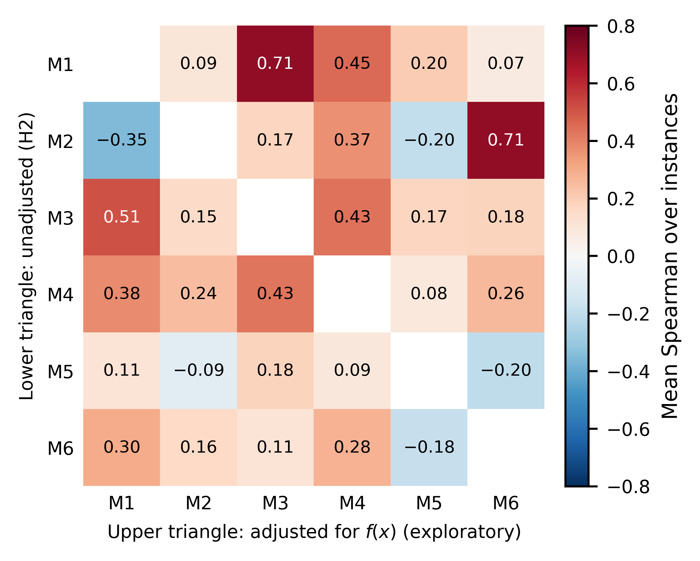
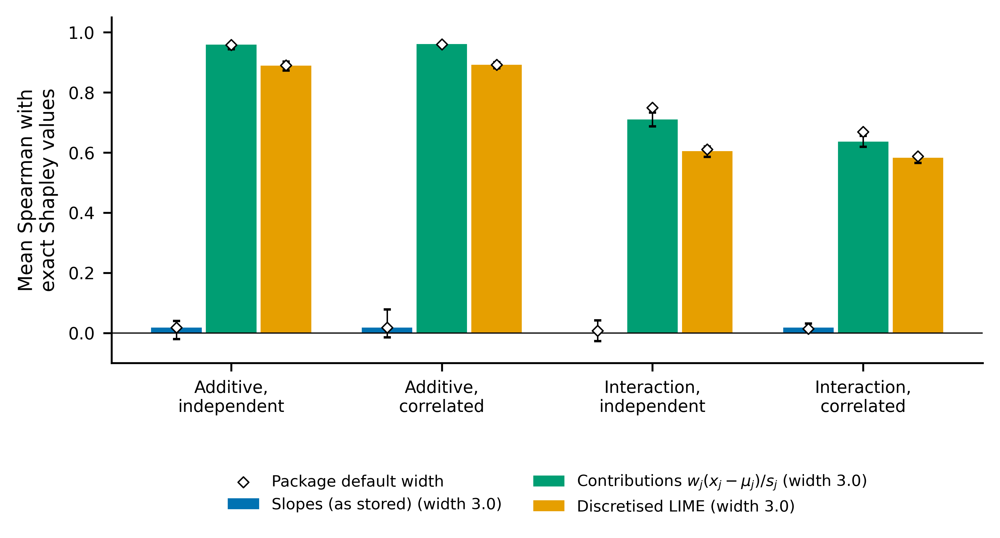
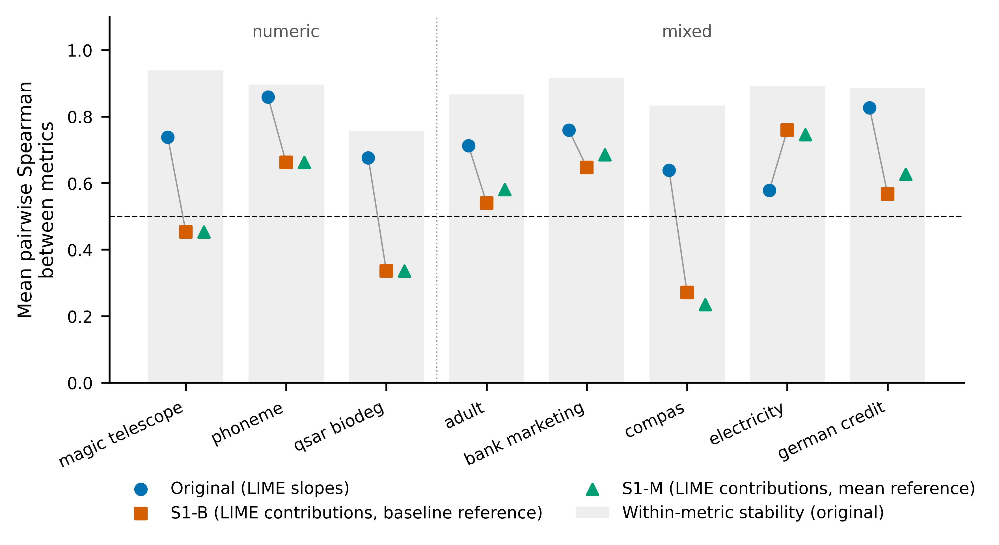
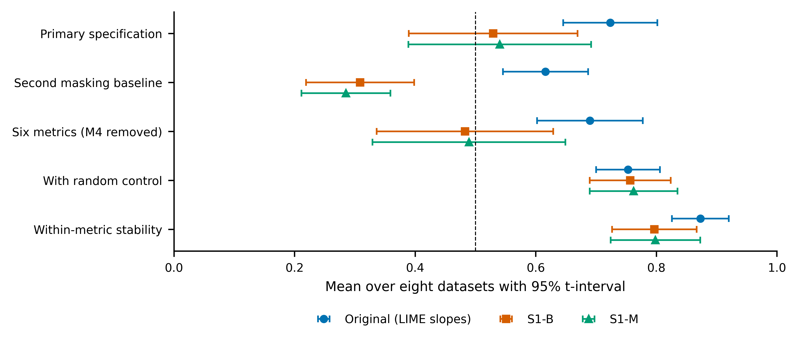
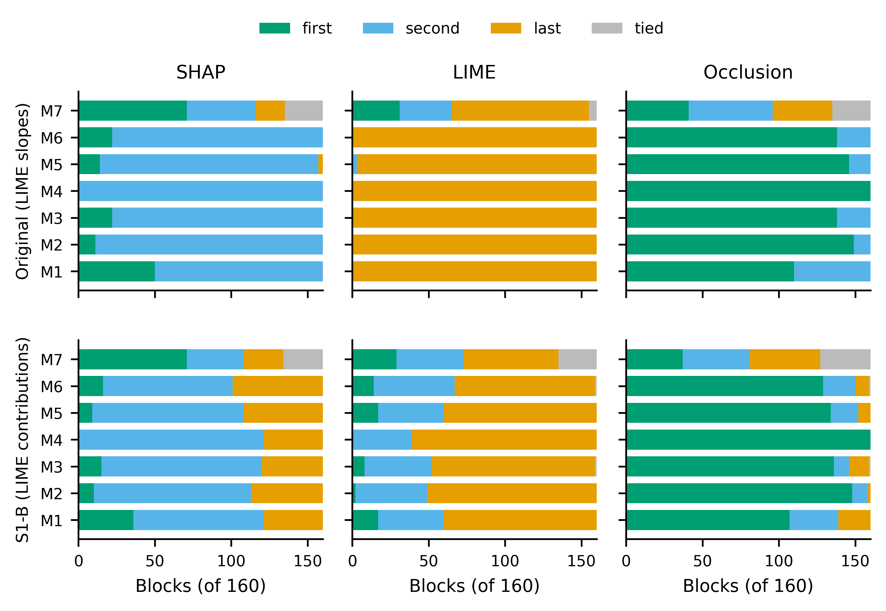

# Paper G — manuscript source (version 0.2, 2026-11-16)

> **Status of this file.** The source of the manuscript. `scripts/build_paper_g.py` renders it to
> `paper_g.md` and `submission/paper_g_blind.docx`: every number is a placeholder
> `<<alias:key:column:format>>` read from the committed result files under
> `outputs/analysis/paper_g/`, every table of results is generated from the same files, figures,
> tables and equations are numbered by label, and citations `[@key]` are resolved from the
> verified references (`references.toml`, `scripts/verify_references.py`). Do not type a result
> into this file by hand (RCA-001). Version 0.1 (2026-11-13) was the pre-run scaffold. The author
> decides content and owns the journal's AI-content limit (decision of 2026-11-13).
> Target: *Informática y Sistemas* (VENUE.md), 8 to 16 pages, APA 7, double-blind.

::: {custom-style="Title"}
Do faithfulness metrics agree? Metric-dependent rankings of post-hoc explanations on tabular data
:::

::: {custom-style="Article Type"}
Manuscript type: Research article
:::

::: {custom-style="Abstract Title"}
Abstract
:::

::: {custom-style="Abstract"}
Claims that one post-hoc explanation method is more faithful than another rest on a faithfulness
metric, and the available metrics operationalise faithfulness differently. This study measured
whether seven common metrics agree, using a paired design: SHAP, LIME, occlusion and a random
control explained four classifiers on eight public tabular datasets (five seeds, 200 instances
per condition), and every explanation was scored by every metric. In the original analysis, with
its hypotheses and decision rule fixed before the run, the metrics broadly agreed on the order of
the explainers (mean pairwise Spearman correlation <<h1:mean_pairwise_spearman:mean:f3>>, 95% CI
[<<h1:mean_pairwise_spearman:lo:f3>>, <<h1:mean_pairwise_spearman:hi:f3>>]) but agreed weakly on
individual explanations (<<h2:h2_omnibus:mean:f3>>). In the configuration used, LIME's
output was a local slope, not the contribution that the metrics assume, and contribution-based
metrics ranked it last in every block. In supplementary analyses specified after this finding and
carrying no test decision, the slopes were unrelated to exact Shapley values
in synthetic data while LIME's surrogate contributions tracked them, and with LIME represented as
contributions on the real data, system-level agreement was
<<cmp:h1_mean_pairwise_spearman_3_explainers_7_metrics__s1_b:mean:f3>>
([<<cmp:h1_mean_pairwise_spearman_3_explainers_7_metrics__s1_b:lo:f3>>,
<<cmp:h1_mean_pairwise_spearman_3_explainers_7_metrics__s1_b:hi:f3>>]), and
<<cmp:h1_second_baseline_spearman__s1_b:mean:f3>> under a second masking baseline, while
instance-level agreement was unchanged. In this study, faithfulness-metric agreement varied with
the level of evaluation, the representation of the attributions and the evaluation protocol.
Comparisons of explainers should declare what their attributions represent, report more than one
metric and masking baseline, and include a random control.
:::

::: {custom-style="Keywords"}
**Keywords:** explainable artificial intelligence; faithfulness metrics; feature attribution; evaluation; tabular data
:::

# 1. Introduction

Post-hoc explanation methods such as SHAP and LIME are widely used to inspect the predictions of
machine-learning models trained on tabular data, including in finance, health and public
administration [@salih2024; @obrienquinn2024; @qureshi2026]. Because different methods can give
different explanations for the same prediction [@krishna2024], their evaluation has become a
research area of its own, and the field still lacks agreed definitions and criteria [@weber2024].
Among the properties evaluated, *faithfulness*, the degree to which an explanation reflects the
reasoning of the model it explains, is usually treated as central [@lyu2024].

Faithfulness cannot be observed directly. It is estimated by perturbing the input according to
the explanation and observing the model's response: removing features in order of importance
(deletion) or restoring them from a baseline (insertion) [@samek2017], masking the most important
features or keeping only them (comprehensiveness and sufficiency) [@deyoung2020], correlating
attributions with the effect of removing single features [@bhatt2020], comparing attributions
with the response to random perturbations (infidelity) [@yeh2019], or retraining the model without
the top features [@hooker2019]. Each estimator encodes a different notion of faithfulness and
depends on choices such as the masking baseline, which can push inputs out of the data
distribution [@zheng2025; @simic2025].

If these metrics disagree, the statement "method A is more faithful than method B" is partly a
statement about the metric. Studies of the metrics themselves have found that fidelity metrics
lack verification and can give different verdicts on the same explanation
[@mironicolau2025], that perturbation-curve scores depend on the model [@edin2025], and that
rankings of attribution methods change with the evaluation setting [@duan2024]. Most of this
evidence comes from images and text; for tabular data, where much applied use of SHAP and LIME
occurs, the evaluation of explanations is less studied [@velmurugan2025].

Earlier studies of the same research programme found that the advantage of one explainer over
another depends on the model and its configuration [@ownB], that SHAP and LIME often disagree on
which features matter for an instance [@ownE], and that explainer rankings vary across datasets
[@ownF]. The present study asks a prior question: whether the measuring instrument itself gives a
consistent answer. It contributes a paired, multi-dataset measurement of agreement between seven
faithfulness metrics, at the level of explainer rankings and of individual explanations, with a
within-metric stability benchmark and a synthetic check against exact attributions. In the course
of the study, a construct mismatch was found in one explainer's output; supplementary experiments
specified after that finding describe how the observed agreement changed when it was removed. The
main finding is that, in this study, faithfulness-metric agreement varied with the level at which
it was evaluated, with the representation of the attributions being compared, and with the
evaluation protocol.

## 1.1. Related work

**Faithfulness metrics and their reliability.** Perturbation-based metrics were introduced for
images [@samek2017] and text [@deyoung2020] and later formalised for general feature attributions
[@yeh2019; @bhatt2020; @hooker2019]. Their reliability has been questioned on several grounds:
removal creates out-of-distribution inputs [@zheng2025; @nieradzik2024], the perturbation method
changes validation outcomes [@simic2025], model calibration affects perturbation-based results
[@decker2025], and scores are not comparable across models without normalisation [@edin2025].
Meta-evaluations construct explanations of known faithfulness to test the metrics
[@zaman2025; @mariotti2024], and benchmarks of evaluation measures in vision report incoherent or
manipulable results [@vandersmissen2024; @chowdhury2024; @fresz2024; @klotz2025]. Subjective,
objective and mathematical evaluation measures need not align either [@kares2027].

**Evaluation frameworks.** Systematic evaluations of methods and metrics show that design choices
such as the model and data type change which method is preferred, and recommend several metrics
[@klein2024; @bommer2024]. Applied tabular evaluations bundle several metrics, for example in
intrusion detection or health [@arreche2024; @qureshi2026], but rarely analyse how the metrics
relate. Benchmark frameworks also bundle faithfulness metrics for tabular explainers
[@agarwal2022], but report them side by side rather than measuring how far they agree. A recent
tabular and image study reports that local explanation rankings depend on the
classifier, the masking operator and the computational budget [@ababneh2026].

**Disagreement.** The disagreement problem concerns explainers that disagree with each other
[@krishna2024; @mitrut2024; @parashar2026; @aggul2026]. Disagreement among the *criteria* of
faithfulness has recently been analysed conceptually, as choices left open by a general
requirement [@shanklin2026]. Impossibility results show that no attribution method can be
reliable for all end tasks on rich model classes [@bilodeau2024], and evaluation without ground
truth has its own limits [@rawal2025; @rahnama2024]. The present study is the empirical
counterpart for tabular data: a paired measurement of how far common metrics agree, with a
benchmark for their own stability and with the role of attribution semantics made explicit.
{{tbl:positioning}} sets it against the closest studies.

Table: Closest studies and how the present study differs. {#tbl:positioning}

| Study | What it examines | Difference in the present study |
|----------------|------------------------------------|------------------------------------|
| @duan2024 | Consistency of attribution-evaluation results across evaluation settings, on images | Tabular data; paired agreement between seven metrics at ranking and instance level |
| @edin2025 | Perturbation-curve scores that are not comparable across models, and their normalisation | Agreement between metric families, not the scale of one metric |
| @mironicolau2025 | Fidelity metrics that lack verification and can disagree on the same explanation | Multi-dataset measurement with a within-metric stability benchmark and the dataset as the unit of inference |
| @ababneh2026 | Dependence of explainer rankings on classifier, masking operator and budget | Agreement among metrics on the same explanations, with the attribution semantics made explicit |
| @shanklin2026 | Conceptual account of why faithfulness criteria disagree | Empirical counterpart with a random control and a synthetic ground-truth check |

::: {custom-style="Source"}
Source: Authors.
:::

# 2. Materials and methods

## 2.1. Design and evidence classes

The design is fully paired: the same instances are explained by every explainer, and the same
explanations are scored by every metric. The factors are 8 datasets × 4 models × 4 explainers ×
7 metrics, with 5 seeds and 200 test instances per dataset, model and seed; a *block* is one
dataset, model and seed (160 blocks). The research questions, the metrics, the H1 statistic,
interval, permutation test and decision rule, and the planned secondary and sensitivity analyses
were fixed in the analysis plan before the run. Other operational details were fixed after the
run had finished but before any metric value, attribution or agreement statistic was examined;
the analysis was then run once, and its outputs were frozen. A review of those outputs led to two
supplementary experiments and four exploratory diagnostics. The evidence is therefore reported in
five classes ({{tbl:evidence_classes}}); results of different classes are never pooled, and only
the H1 classification carries a decision.

| Class | Content | When specified |
|---|---|---|
| Pre-specified | Research questions H1 and H2; metrics and their directions; H1 statistic, dataset-level *t*-interval, dataset-unit permutation test and decision rule; Holm correction over H1 and H2; the H2 estimate; winner flips, SHAP–LIME order, second masking baseline, random control, per-model summaries; synthetic-check design | Before the run |
| Pre-unblinding clarifications | Seven metrics and the three studied explainers as the primary H1 population; ties and undefined correlations; degenerate M4 values kept as stored; the within-metric stability benchmark; H2 orientation, *t*-interval, one-sided *t*-test, sign-flip test and Holm over its 15 pairs; the synthetic statistic; raw permutation *p* for the decision table; the six-metric sensitivity; the M4-exclusion sensitivity; the retrospective dataset check; omission of the variance shares | After the run, before any result was examined |
| Original analysis | The two classes above, run once on the frozen data; outputs frozen | After the pre-unblinding clarifications |
| Supplementary experiments | S3 (synthetic LIME representations) and S1 (LIME as surrogate contributions; S1-B primary, S1-M sensitivity) | After the original results were reviewed |
| Exploratory diagnostics | Explainer positions; *f(x)*-adjusted instance-level correlations; M7 removal sets and ties; random control last | After the original results were reviewed |

Table: Classes of evidence and when each was specified. {#tbl:evidence_classes}

::: {custom-style="Source"}
Source: Authors.
:::

## 2.2. Datasets and models

Eight public binary classification datasets were taken from OpenML [@bischl2025], two from each of
four strata of feature composition and size ({{tbl:datasets}}). The list was fixed before any
explanation was computed. The eligibility rule required a five-fold cross-validated AUC between
0.65 and 0.98 for at least two of the four models. The check was specified before the run but
executed after it, as a retrospective diagnostic; no dataset was to be removed whatever its
outcome. All eight datasets passed with all four models (AUC from <<sum:gate:min:f3>> to
<<sum:gate:max:f3>>).

Table: Datasets, number of raw features and five-fold cross-validated AUC per model (LR logistic regression, RF random forest, XGB XGBoost, MLP multilayer perceptron). {#tbl:datasets}

<<table:datasets>>

::: {custom-style="Source"}
Source: Authors.
:::

Logistic regression with L2 penalty, random forest, XGBoost [@chen2016] and a multilayer
perceptron were trained with one configuration for all datasets, recorded before training.
Numeric features were standardised, categorical features one-hot encoded and missing values
imputed. Each seed fixed a stratified 80/20 split, the model, the explainers' sampling and the
random control. All datasets are public, de-identified benchmark tables; the study involved no
human participants.

## 2.3. Explainers and their reference points

The explainers differ in what their output represents and, for those that output contributions,
in the reference point the contribution is measured from.

- **SHAP** [@lundberg2017; @li2024]: interventional TreeSHAP on the predicted probability for the
  tree models and KernelSHAP (no feature selection) for logistic regression and the multilayer
  perceptron, both with a background sample of 50 training rows. The output is an additive
  contribution relative to the model's expected output over that background sample.
- **Occlusion:** the change in predicted-class probability when one feature alone is set to the
  metrics' masking baseline *b* (Section 2.4); a contribution relative to *b* for that feature
  only, without interactions.
- **LIME** [@ribeiro2016] for tabular data (package 0.2.0.1) with continuous features not
  discretised (*discretize_continuous* false), kernel width 3.0 (the package default is
  0.75·√*p*), 1,000 samples drawn around the training mean, and all features. In this
  configuration LIME returns the coefficients of a locally weighted linear surrogate fitted on
  standardised features: a slope per training standard deviation, whose sign is the direction of
  change and not whether the feature's current value raises the prediction. It has no reference
  point and is not a per-feature contribution. One-hot columns are sampled as continuous values,
  so the surrogate is fitted partly on points off the one-hot manifold [@ademi2025; @knab2025].
- **Random control:** attributions drawn from a standard normal distribution with a fixed seed.

Attributions of one-hot columns were summed per raw feature, and every attribution was oriented
to the predicted class. The LIME output representation was decided in the original configuration
and is reported as run; it is examined by the supplementary experiments (Section 2.6).

## 2.4. Faithfulness metrics

Let *f(x)* be the predicted-class probability, *a* the oriented attribution vector over the *G*
raw features, *b* the masking baseline (training mean for numeric features, the one-hot of the
training mode for categorical ones), and *x*~*S*←*b*~ the instance with the features in *S* set to
*b* (all columns of a one-hot feature together). Let *π* order the features by decreasing *a*
(ties by index) and *T* = {*π*~1~, …, *π*~*k*~} be the top *k* = max(1, ⌈0.2*G*⌉) features.
Deletion (M1) and insertion (M2) are the trapezoidal areas over *G* + 1 equally spaced points
(step 1/*G*) of the curves *p*~*t*~ = *f*(*x*~{*π*1..*πt*}←*b*~), which masks the first *t* features,
and *q*~*t*~ = *f*(*x*~{*πt+1..πG*}←*b*~), which restores the first *t* features to a fully masked
instance, for *t* = 0, …, *G* ({{eq:deletion}}). The endpoints are *p*~0~ = *q*~*G*~ = *f(x)* and
*p*~*G*~ = *q*~0~ = *f(b)*:

$$M_1 = \frac{1}{G}\Big[\frac{p_0 + p_G}{2} + \sum_{t=1}^{G-1} p_t\Big], \qquad M_2 = \frac{1}{G}\Big[\frac{q_0 + q_G}{2} + \sum_{t=1}^{G-1} q_t\Big]$$ {#eq:deletion}

The top-*k* prediction gap (M3) masks the top features and sufficiency (M6) masks all others
({{eq:gap}}):

$$M_3 = f(x) - f\big(x_{T\leftarrow b}\big), \qquad M_6 = f(x) - f\big(x_{\bar{T}\leftarrow b}\big)$$ {#eq:gap}

Faithfulness correlation (M4) [@bhatt2020] is the Pearson correlation between *a*~*i*~ and the
single-feature effect *Δ*~*i*~ = *f(x)* − *f*(*x*~{*i*}←*b*~); when *a* or *Δ* is constant the
correlation is undefined, and the frozen code stores 0 and flags the score
(<<sum:m4deg:degenerate:d>> of <<sum:m4deg:rows:int>> scores). Infidelity (M5) [@yeh2019] is used
in a scale-free form ({{eq:infidelity}}): over *R* = 100 random subsets *S*~*r*~ (each feature masked
independently with probability 0.5; a subset that masks nothing is given one randomly chosen
feature; the subsets are shared by all explainers of an instance), with
*Δ*~*r*~ = *f(x)* − *f*(*x*~*Sr*←*b*~) and *s*~*r*~ = Σ~*i*∈*Sr*~ *a*~*i*~,

$$M_5 = \frac{\sum_{r=1}^{R}\big(\Delta_r - \hat\beta s_r\big)^2}{\sum_{r=1}^{R}\Delta_r^2}, \qquad \hat\beta = \frac{\sum_{r} s_r\Delta_r}{\sum_{r} s_r^2}$$ {#eq:infidelity}

that is, one minus the uncentred *R*² of the least-squares fit of *Δ* on *s* without intercept
(*M*~5~ = 0 if all *Δ*~*r*~ are 0 and 1 if all *s*~*r*~ are 0); subset masking replaces Gaussian
noise, which is undefined for categorical features. M7, ROAR-lite [@hooker2019], ranks features by
the mean |*a*| over an explainer's 200 instances; for each share ℓ ∈ {10%, 20%, 30%, 50%} the top
max(1, ⌈ℓ*G*⌉) features are set to *b* in the training and test data, the model is retrained, and
M7 is the mean over ℓ of the drop in test AUC; it has one value per block and explainer. Lower is
better for M1, M5 and M6, and higher for M2, M3, M4 and M7; all metrics were oriented so that
higher means more faithful before ranking. M1 to M6 read attributions as signed contributions
relative to *b*: occlusion's output is of that kind, SHAP's is a contribution relative to a
different reference (the background expectation), and LIME's slopes are not contributions; M7
uses only magnitudes. M4 and occlusion share their construction (single-feature masking), so M4
is expected to favour occlusion. The second masking baseline replaces *b* by one training row
drawn at random for each instance (the same row for every explainer).

## 2.5. Agreement analysis

**System level (H1).** In each block *u*, the three studied explainers (SHAP, LIME, occlusion)
were ranked under each metric: by their mean score over the 200 instances for M1 to M6 and by
the block's value for M7, with average ranks for ties. The block's agreement is the mean Spearman
correlation over the set *D*~*u*~ of metric pairs whose correlation is defined
({{eq:agreement}}):

$$\bar\rho_u = \frac{1}{|D_u|}\sum_{(m,m')\in D_u} \rho_s\big(r_m, r_{m'}\big)$$ {#eq:agreement}

where *r*~*m*~ is the explainers' rank vector under metric *m* and *ρ*~*s*~ the Spearman
correlation, computed as the Pearson correlation of the two rank vectors. A pair is undefined when
either rank vector is constant (all explainers tied); it is left out, never set to 0. Without
ties |*D*~*u*~| = 21; in the original analysis
<<sum:undef:pairs:d>> pairs were undefined, in <<sum:undef:blocks:d>> of the 160 blocks. Kendall's
*W* with tie correction is reported beside it. Because the 20 blocks of a dataset are not
independent, the dataset was the unit of inference: the block values were averaged within each
dataset, and the estimate is the mean of the eight dataset means with a 95% *t*-interval. The null
hypothesis that the metrics rank the explainers independently was tested by a permutation test
that applied one permutation of the explainer labels per dataset and metric to all blocks of that
dataset (100,000 permutations, one-sided). A simulation run before the experiment showed that
permuting within blocks inflates false positives when blocks are correlated, and that a percentile
bootstrap over eight datasets undercovers.

**Within-metric stability benchmark (pre-unblinding).** For each dataset, model and metric, the
order of the studied explainers in each seed was compared with every other seed (ten seed pairs,
Spearman; undefined pairs left out), and the values were averaged over models and metrics within
each dataset. Seeds change the split, the model and the explainers' sampling, so the benchmark is
a reference level for between-metric agreement, not an upper bound.

**Instance level (H2).** The plan fixed the question (whether pairs of metrics correlate
positively across instances) and the estimate: for each block and explainer (all four), the
Spearman correlation across the 200 instances for each of the 15 pairs of M1 to M6, with metrics
oriented, averaged within the block and then within the dataset. Its inference was fixed after
the run and before unblinding: the *t*-interval over the eight dataset values, a one-sided
*t*-test of a positive mean (the test entering the Holm correction with H1), an exact sign-flip
test as a supplement, and Holm correction over the 15 pair tests.

**Decision rule.** The classification of {{tbl:decision}} was fixed before the run; that it uses
the raw permutation *p* of H1, with the Holm-adjusted *p* over H1 and H2 reported beside it, was
fixed before unblinding. With three ranked explainers, if one explainer holds the same first or
last rank under every metric in a block, each pairwise correlation is 0.5 or 1, so the block's
agreement cannot fall below 0.5; the classification is therefore read with the distribution of
explainer positions.

Table: Decision rule for H1, fixed before the run. {#tbl:decision}

<<table:decision>>

::: {custom-style="Source"}
Source: Authors.
:::

**Secondary and sensitivity analyses.** Pre-specified: the share of blocks in which the
top-ranked explainer changes between two metrics (winner flips; ties at the top counted
separately); strict SHAP–LIME order reversals; the analysis with the random control as a fourth
explainer; M1, M2, M3 and M6 recomputed with the second baseline; and per-model summaries. Fixed
before unblinding: the analysis without M4 (six metrics), and an exploratory analysis that leaves
out the flagged M4 scores, which the primary analysis keeps as stored. A planned variance
decomposition was omitted because its specification was incomplete, a deviation from the plan.

**Synthetic check.** Four synthetic conditions used known functions directly as the model: an
additive logistic function and one with two pairwise interactions, each with eight standard normal
features, independent or correlated (pairwise correlation 0.5). Exact interventional Shapley
values of the predicted-class probability, with the expectation over 500 background rows of the
same distribution, served as true attributions [@rahnama2024; @islam2025]. For each condition and
seed, the explainers were ordered by their mean Spearman correlation with the truth (the reference
order), and each of M1 to M6 was scored by the Spearman correlation between its order of the
explainers and the reference order (statistic fixed before unblinding).

## 2.6. Supplementary experiments and exploratory diagnostics

A review of the original outputs found the LIME representation issue of Section 2.3 (the same
behaviour had been documented in an earlier study of the programme [@ownE]). The following
analyses were specified after that review, with their outputs written separately from the
original results, which were not modified; they carry no test decision.

**S3, synthetic validation of LIME representations.** In the synthetic conditions (numeric
features only), three representations of LIME were compared with the exact Shapley values
(instance-level Spearman correlation): the stored slopes; the contributions of LIME's fitted
surrogate relative to its training mean, *w*~*j*~(*x*~*j*~ − *μ*~*j*~)/*s*~*j*~; and LIME with
quartile discretisation; each at kernel width 3.0 and at the package default.

**S1, LIME as surrogate contributions on the real data.** LIME was re-explained with the frozen
configuration on the same instances, and its fitted surrogate was represented as the contribution
of each raw feature relative to a reference *r* ({{eq:contribution}}), oriented to the predicted
class:

$$c_j(r) = \sum_{k \in G_j} w_k\,\frac{x_k - r_k}{s_k}$$ {#eq:contribution}

where *G*~*j*~ is the set of encoded columns of feature *j*, *w*~*k*~ the surrogate's coefficient on
standardised column *k*, and *s*~*k*~ the scale LIME fitted to that column. The two variants differ
only in *r*. In S1-B, the primary variant, *r* is the metrics' masking baseline *b*, so S1-B
contributions are relative to the same point as occlusion and the metrics (but not as SHAP); a
categorical feature at its training mode contributes 0. In S1-M, the sensitivity variant, *r* is
LIME's training mean *μ*, whose categorical coordinates are the dummy shares, a point off the
one-hot manifold. For numeric features *b* = *μ*, so the variants coincide. Both are contributions
of the surrogate, not of the model; for categorical features the surrogate was fitted to
off-manifold one-hot samples. Every instance was reconstructed and checked against the stored run
before use, and the metrics were recomputed on the S1 attributions; the analyses of Section 2.5
were then repeated with the S1 LIME rows substituted for the original ones and every other row
unchanged.

**Exploratory diagnostics.** The frequency with which each explainer holds each rank under each
metric (positions); the instance-level correlations adjusted for the predicted-class probability
by a rank-based partial correlation, because M1, M2, M3 and M6 contain *f(x)* by construction
({{eq:deletion}}, {{eq:gap}}); the size of M7's removal sets and the frequency of identical sets
and tied scores; and the share of blocks in which every metric places the random control last.

## 2.7. Reproducibility

Code, configuration, per-instance scores and every analysis output are released under an open
licence (archive identifier withheld for double-blind review). All numbers in this article are
rendered by a script from the committed result files and re-derived by an automated check. The
remaining parameters, the seeds and the software versions are listed in Appendix A. The runs used one laptop (Intel Core i5-1335U CPU, Linux) with a
fixed software environment.

# 3. Results and discussion

## 3.1. Broad agreement under the original attribution representations (original analysis)

At system level, the mean pairwise Spearman correlation between metrics was
<<h1:mean_pairwise_spearman:mean:f3>> (95% CI [<<h1:mean_pairwise_spearman:lo:f3>>,
<<h1:mean_pairwise_spearman:hi:f3>>]) and Kendall's *W* <<h1:kendall_w:mean:f3>>
([<<h1:kendall_w:lo:f3>>, <<h1:kendall_w:hi:f3>>]). The permutation test gave
*p* = <<perm:h1_permutation:p:zf5>> (the smallest value attainable with
<<perm:h1_permutation:permutations:int>> permutations), and *p* = <<mult:h1:p_holm:zf5>> after
Holm correction over H1 and H2. With the interval above 0.5, the frozen decision rule classifies
the result as "the metrics broadly agree", both before and after correction. The within-metric
stability benchmark was <<stab:within_metric_stability:mean:f3>>
([<<stab:within_metric_stability:lo:f3>>, <<stab:within_metric_stability:hi:f3>>]), so the
between-metric estimate was lower than the within-metric benchmark (no test compares them). Agreement was
lowest for random forests (<<pm:rf:h1_mean:f3>>) and highest for logistic regression
(<<pm:logreg:h1_mean:f3>>). Leaving out the flagged M4 scores (exploratory) gave the same estimate
(<<m4x:h1_m4_degenerate_excluded:mean:f3>>).

At instance level, agreement was weak: the mean correlation between metric pairs across instances
was <<h2:h2_omnibus:mean:f3>> ([<<h2:h2_omnibus:lo:f3>>, <<h2:h2_omnibus:hi:f3>>];
one-sided *t*-test *p* = <<h2:h2_omnibus:p_t:zf5>>, sign-flip *p* = <<h2:h2_omnibus:p_sign_flip:zf4>>, the smallest attainable with eight
datasets).
With the inference fixed before unblinding (Section 2.5), H2 is supported as a positive mean,
but its size is small, and the pairs differed in sign:
deletion and insertion correlated negatively (<<h2p:m1_deletion_m2_insertion:mean:f3>>), as did
infidelity and sufficiency (<<h2p:m5_infidelity_m6_sufficiency:mean:f3>>), whereas deletion and
the top-*k* gap correlated most strongly (<<h2p:m1_deletion_m3_gap:mean:f3>>; {{fig:h2_matrix}}).

These results are reported exactly as the frozen analysis produced them; the H1 classification
is the study's only decision. They describe agreement among the metrics for the explainer outputs
*as stored*; as Section 2.3 explains, LIME's stored output was a
slope, while M1 to M6 read attributions as contributions. Sections 3.3 and 3.4 show what this
means for the result.

{#fig:h2_matrix}

## 3.2. Pre-specified sensitivity analyses

The second masking baseline lowered system-level agreement to
<<sens:h1_second_baseline:spearman_mean:f3>> ([<<sens:h1_second_baseline:spearman_lo:f3>>,
<<sens:h1_second_baseline:spearman_hi:f3>>]); removing M4 gave
<<sens:h1_circularity_m4_removed_for_all_explainers_six_metrics:spearman_mean:f3>>, and adding the
random control as a fourth explainer <<sens:h1_four_explainers:spearman_mean:f3>>. The explainer
ranked first changed between two of M1 to M6 in <<sum:flips_orig_m16:min:pct1>>% to
<<sum:flips_orig_m16:max:pct1>>% of blocks, and between M7 and another metric in
<<sum:flips_orig_m7:min:pct1>>% to <<sum:flips_orig_m7:max:pct1>>%. In the synthetic check, the
metrics' order of the four explainers agreed with the reference order with a mean Spearman
correlation from <<syn:m5_infidelity:mean:f2>> (M5) to <<syn:m1_deletion:mean:f2>> (M1); the
reference order itself placed LIME third or fourth of four in all <<sum:synref:lime_low:d>>
conditions and seeds, which, given its slope output, reflects the representation rather than the
method (Section 3.3).

## 3.3. LIME's output representation against exact attributions (S3, supplementary)

In the synthetic conditions, the stored slopes were unrelated to the exact Shapley values (mean
Spearman <<s3:additive_rho00__s3_a:mean_over_seeds:f2>> with independent and
<<s3:additive_rho50__s3_a:mean_over_seeds:f2>> with correlated additive features), whereas the surrogate
contributions of the same fitted LIME model agreed closely in the additive conditions
(<<s3:additive_rho00__s3_b:mean_over_seeds:f2>> with independent and
<<s3:additive_rho50__s3_b:mean_over_seeds:f2>> with correlated features) and moderately with interactions
(<<s3:interaction_rho50__s3_b:mean_over_seeds:f2>> to
<<s3:interaction_rho00__s3_b:mean_over_seeds:f2>>). Discretised LIME lay between them
(<<s3:interaction_rho50__s3_c:mean_over_seeds:f2>> to
<<s3:additive_rho50__s3_c:mean_over_seeds:f2>>), and the kernel width changed little
({{fig:s3}}). In these synthetic conditions, then, the same fitted surrogate tracked the true
attributions when read as a contribution and did not when read as slopes.

{#fig:s3}

## 3.4. Agreement with LIME represented as contributions (S1, supplementary)

With S1-B, system-level agreement fell from <<cmp:h1_mean_pairwise_spearman_3_explainers_7_metrics__original:mean:f3>>
to <<cmp:h1_mean_pairwise_spearman_3_explainers_7_metrics__s1_b:mean:f3>>
([<<cmp:h1_mean_pairwise_spearman_3_explainers_7_metrics__s1_b:lo:f3>>,
<<cmp:h1_mean_pairwise_spearman_3_explainers_7_metrics__s1_b:hi:f3>>]), an interval that contains
0.5, and Kendall's *W* from <<cmp:h1_kendall_w__original:mean:f3>> to
<<cmp:h1_kendall_w__s1_b:mean:f3>> ({{tbl:evidence}}). Agreement fell in seven of the eight
datasets, most for compas (<<cds:compas:original:f3>> to <<cds:compas:S1-B:f3>>) and qsar biodeg
(<<cds:qsar_biodeg:original:f3>> to <<cds:qsar_biodeg:S1-B:f3>>), and rose for electricity
(<<cds:electricity:original:f3>> to <<cds:electricity:S1-B:f3>>; {{fig:agreement_datasets}}). The
mean over the numeric datasets fell from <<sum:type_numeric:original:f3>> to
<<sum:type_numeric:S1-B:f3>>, and over the mixed ones from <<sum:type_mixed:original:f3>> to
<<sum:type_mixed:S1-B:f3>>. Under the second masking baseline, S1-B agreement was
<<cmp:h1_second_baseline_spearman__s1_b:mean:f3>>, against
<<cmp:h1_second_baseline_spearman__original:mean:f3>> originally ({{fig:sensitivity}}).
Instance-level agreement was unchanged (<<cmp:h2_omnibus_4_explainers__s1_b:mean:f3>>), and so
was its pattern: deletion and insertion still correlated negatively
(<<h2a_s1b:m1_deletion_m2_insertion:unadjusted_mean:f3>>). The two S1 variants differed by at
most <<sum:s1diff:max:f3>> in any summary quantity, so the choice between the two references
did not change these descriptions. The within-metric stability benchmark also fell with S1-B,
from <<cmp:within_metric_stability_benchmark__original:mean:f3>> to
<<cmp:within_metric_stability_benchmark__s1_b:mean:f3>>: rankings with LIME represented as
contributions were less stable across seeds, which may account for part of the fall in
between-metric agreement. The fall in between-metric agreement was more than twice as large,
however, which is consistent with metrics ordering the same explainers differently and not only
with noisier rankings. No decision rule is applied to S1; the H1 classification of
Section 3.1 stands for the representation it was made on.

Table: System-level and instance-level agreement under the three LIME representations (mean over eight datasets with 95% *t*-interval; counts of the 160 blocks). Original column: ^O^ original analysis, ^S^ pre-specified sensitivity analysis, ^C^ exploratory; the S1 columns are supplementary. {#tbl:evidence}

<<table:evidence>>

::: {custom-style="Source"}
Source: Authors.
:::

{#fig:agreement_datasets}

{#fig:sensitivity}

## 3.5. Explainer positions (exploratory)

Under the original representation, LIME was ranked last by each of M1, M2, M3, M4 and M6 in all
<<r3:blocks:value:d>> blocks (and by M5 in <<sum:lastm16:m5_infidelity:d>>), and was the untied
last explainer under all seven metrics in <<r3:of_which_lime_last:value:d>> blocks
({{fig:positions}}). In each of those blocks every pairwise correlation is 0.5 or 1 by
construction (Section 2.5), so their contribution to the original estimate reflects agreement on
the last position at least. With S1-B, LIME was last
under all seven metrics in <<pos_s1b:of_which_lime_last:value:d>> blocks, and was last under M1
in <<posm_s1b:m1_deletion__lime:r3:d>> blocks; the order of the three explainers then varied
between metrics, and strict SHAP–LIME reversals between two of M1 to M6 occurred in
<<sum:revs_s1b_m16:min:pct1>>% to <<sum:revs_s1b_m16:max:pct1>>% of blocks (original
<<sum:revs_orig_m16:min:pct1>>% to <<sum:revs_orig_m16:max:pct1>>%); in pairs with M7, which uses only
magnitudes, they occurred in <<sum:revs_orig_m7:min:pct1>>% to <<sum:revs_orig_m7:max:pct1>>% of blocks originally and
<<sum:revs_s1b_m7:min:pct1>>% to <<sum:revs_s1b_m7:max:pct1>>% with S1-B. Occlusion was ranked first
by M4 in all <<posm_orig:m4_corr__occlusion:r1:d>> blocks under both representations, as the
shared construction of M4 and occlusion predicts.

{#fig:positions}

## 3.6. Instance-level agreement adjusted for the prediction (exploratory)

Adjusting the instance-level correlations for the predicted-class probability raised their mean
from <<r6:omnibus:unadjusted_mean:f3>> to <<r6:omnibus:adjusted_mean:f3>>
([<<r6:omnibus:adjusted_lo:f3>>, <<r6:omnibus:adjusted_hi:f3>>]). The negative correlation
between deletion and insertion largely disappeared (<<r6:m1_deletion_m2_insertion:adjusted_mean:f3>>),
and insertion and sufficiency became strongly related (<<r6:m2_insertion_m6_sufficiency:adjusted_mean:f3>>;
{{fig:h2_matrix}}). By construction ({{eq:deletion}}, {{eq:gap}}), after orientation *f(x)* enters
M2 and M3 with a positive coefficient and M1 and M6 with a negative one; the pairs whose
correlation rose after adjustment include those with opposite coefficients. This is consistent
with a shared dependence on *f(x)* acting on these pairs, but the adjustment is a partial
correlation on the observed data and does not isolate that mechanism. Even adjusted, instance-level agreement remained far below system-level
agreement, under every representation (<<cmp:h2_omnibus_adjusted_for_f_x_exploratory__s1_b:mean:f3>>
with S1-B).

## 3.7. Retraining metric and random control (exploratory)

M7 was the least stable metric: its agreement with itself across seeds was
<<stm_orig:m7_roar:mean:f3>> under the original representation and <<stm_s1b:m7_roar:mean:f3>>
with S1-B, and winner flips involving M7 occurred in <<sum:flips_s1b_m7:min:pct1>>% to
<<sum:flips_s1b_m7:max:pct1>>% of blocks with S1-B. Its removal sets are small when there are few
features (phoneme has <<r7g:phoneme:G:d>> raw features, so the first removal level removes
<<r7g:phoneme:k_0.1:d>>), different explainers then often remove the same set, and their scores
tie; ties between explainers were most frequent for logistic regression
(<<r7t:logreg:any_equal_pair:pct0>>% of its blocks). The random control was the untied last
explainer under all seven metrics in <<r11:all:untied_last_all7:d>> of 160 blocks under the
original representation and in <<rl_s1b:all:untied_last_all7:d>> with S1-B; only with
comparable LIME attributions did it behave as a negative control should.

## 3.8. Discussion

The results bear on three conditions of faithfulness-metric agreement. Each statement below is
marked as a property of the computation, an observed association, or a possible mechanism that
the study did not isolate.

**Level of evaluation.** *Observed:* system-level agreement was
<<h1:mean_pairwise_spearman:mean:f3>> in the original analysis and
<<cmp:h1_mean_pairwise_spearman_3_explainers_7_metrics__s1_b:mean:f3>> with S1-B, whereas the
mean instance-level correlation was <<h2:h2_omnibus:mean:f3>> originally and
<<cmp:h2_omnibus_4_explainers__s1_b:mean:f3>> with S1-B, and some metric pairs correlated
negatively. *Property of the computation:* after orientation *f(x)* enters M2 and M3 with a positive
coefficient and M1 and M6 with a negative one, so their instance-level correlations depend
partly on how *f(x)* varies across instances; *observed:* adjusting for *f(x)* raised the mean to
<<r6:omnibus:adjusted_mean:f3>>, still well below the system-level values. Agreement on how explainers rank on average therefore
did not carry over to agreement on individual explanations, the use made of explanations in
practice [@rawal2025; @bilodeau2024].

**Attribution semantics.** *Observed:* the original "broad agreement" was obtained with an
explainer whose output was a slope, scored by metrics that read contributions, and that
explainer was ranked last by each of M1, M2, M3, M4 and M6 in every block. *Property of the
computation:* in any block where one explainer is last under every metric, each pairwise
correlation is 0.5 or 1. *Observed:* with LIME represented as contributions of the same fitted
surrogate, LIME was no longer last in most blocks and agreement was
<<cmp:h1_mean_pairwise_spearman_3_explainers_7_metrics__s1_b:mean:f3>>, with an interval
containing 0.5; the within-metric stability benchmark also fell, but by less than half as much
(Section 3.4), so lower stability alone does not explain the change. *Possible mechanism, not isolated:* reading slopes as contributions lowered
LIME's scores under the contribution-based metrics, which is consistent with S3, where the slopes
were unrelated to exact Shapley values while the contributions tracked them; on the real data S1
changes the representation only, but no ground truth exists there. The study shows one case; it
does not establish how often representation mismatches arise for other explainers. It
complements the conceptual account of why faithfulness criteria disagree [@shanklin2026], and it
suggests that the reference point of each attribution deserves explicit reporting, since SHAP,
occlusion, S1-B and S1-M measure contributions from different points [@li2024; @sokol2025;
@knab2025].

**Evaluation protocol.** *Observed:* with S1-B, agreement was
<<cmp:h1_second_baseline_spearman__s1_b:mean:f3>> under the second masking baseline, against
<<cmp:h1_mean_pairwise_spearman_3_explainers_7_metrics__s1_b:mean:f3>> under the primary one,
consistent with reports that perturbation choices change validation outcomes [@simic2025;
@zheng2025; @ababneh2026]; the study did not compare the size of this change with that of other
protocol choices by a test. The retraining metric had the lowest within-metric stability and
tied often on datasets with few features; metric pairs flipped the winner in up to
<<sum:flips_s1b_m16:max:pct1>>% of blocks even among M1 to M6 with S1-B; and M4 ranked first the
explainer that shares its construction. *Property of the computation:* with three explainers, one
consistently last explainer is enough to satisfy a 0.5 threshold, so aggregate agreement
statistics need the explainers' positions beside them [@duan2024; @edin2025].

**Recommendations.** Comparisons of explainers on tabular data should (1) declare what each
explainer's output represents and its reference point, and check it against what each metric
assumes; (2) report at least two metrics from different families and at least two masking
baselines; (3) include a random control and report how often it ranks last; (4) report a
within-metric stability benchmark and the explainers' rank positions next to any aggregate
agreement statistic; and (5) separate claims about rankings from claims about individual
explanations.

# 4. Conclusions

Faithfulness metrics agreed broadly on the order of explainers in the original analysis, and
weakly on individual explanations. That system-level agreement was obtained with an explainer
whose output did not match what the metrics assume; with LIME represented as surrogate
contributions, agreement was moderate, its interval contained 0.5, and it was lower under a second
masking baseline, while instance-level agreement stayed weak. In this study, then, whether the
metrics agreed depended on the level of evaluation, on how the attributions were represented and
on the evaluation protocol. Claims that one explainer is more faithful than another should state
all three. Future work should extend the comparison to explainers with declared reference
semantics, to more masking schemes and to regression and multiclass tasks.

# Funding

This research received no external funding.

# Author contributions

Withheld for double-blind review; stated in CRediT terms at acceptance.

# Conflicts of interest

The author declares no conflicts of interest.

# Data availability statement

The datasets are public on OpenML (identifiers in {{tbl:datasets}}). Code, configuration,
per-instance scores and all analysis outputs are openly available in an archived repository whose
persistent identifier is withheld for double-blind review and will be added at acceptance.

# Declaration of generative AI use

The author used the AI tool Claude (Anthropic), under the author's direction, to help write the
analysis code, edit the English text and format the references. The research question, the plan,
the design and the interpretation are the author's. The author reviewed all content and takes
full responsibility for it.

# Appendix A. Model parameters and software

{{tbl:params}} lists the settings not given in Section 2, the seeds and the software versions.

Table: Parameters, seeds and software of the run (frozen configuration and run host record). {#tbl:params}

| Component | Setting |
|------------------|----------------------------------------------------------------|
| Seeds | 42, 123, 456, 789, 101112 |
| Preprocessing | Numeric features standardised; categorical features one-hot encoded, at most 20 levels (rarer levels grouped); missing values imputed |
| Logistic regression | L2 penalty, *C* = 1.0, at most 1,000 iterations |
| Random forest | 100 trees, other settings at the package defaults |
| XGBoost | 100 trees, maximum depth 4, learning rate 0.1 |
| Multilayer perceptron | One hidden layer of 100 units, at most 500 iterations |
| Software | Python 3.13.12; numpy 2.2.6, pandas 2.3.3, scipy 1.16.3, scikit-learn 1.7.1, xgboost 3.1.2, shap 0.50.0, lime 0.2.0.1 |

::: {custom-style="Source"}
Source: Authors.
:::
