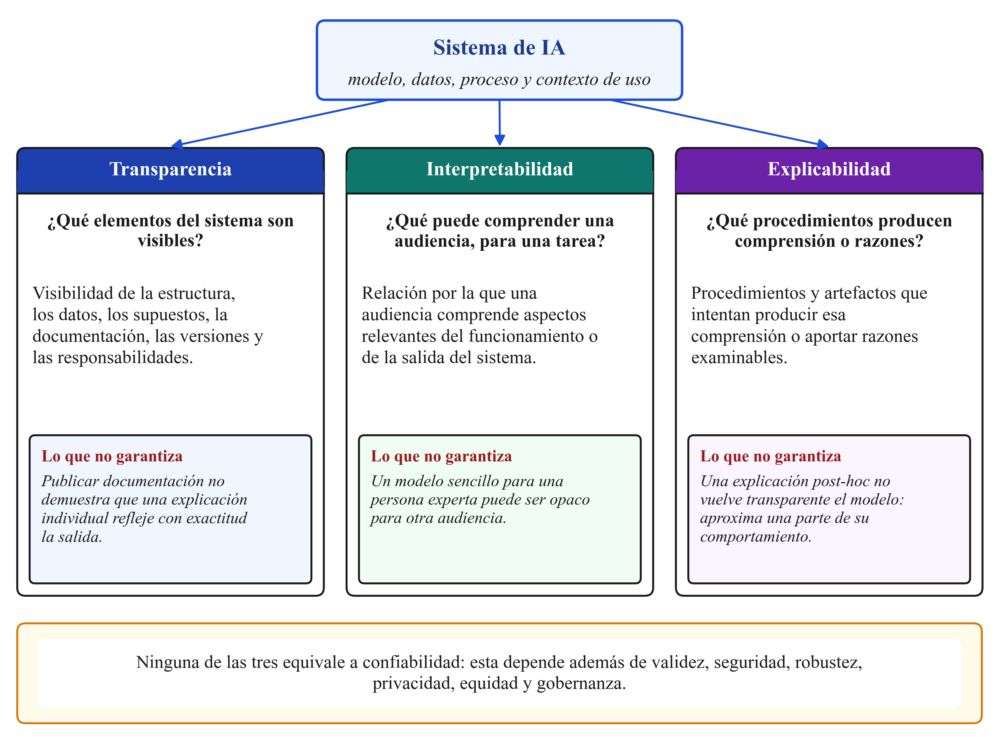
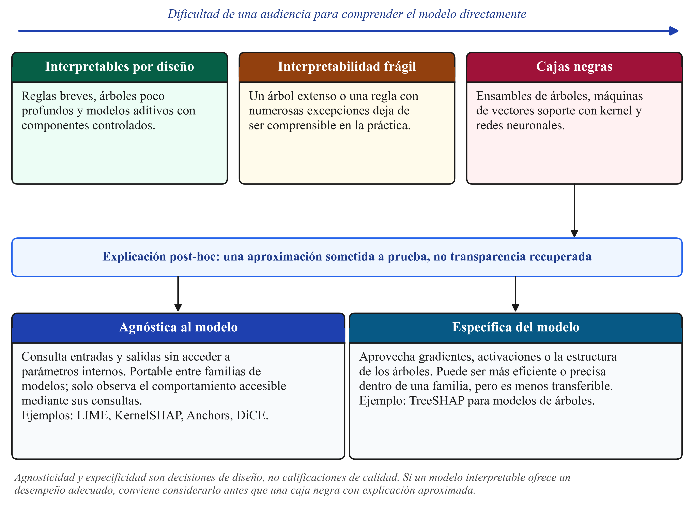
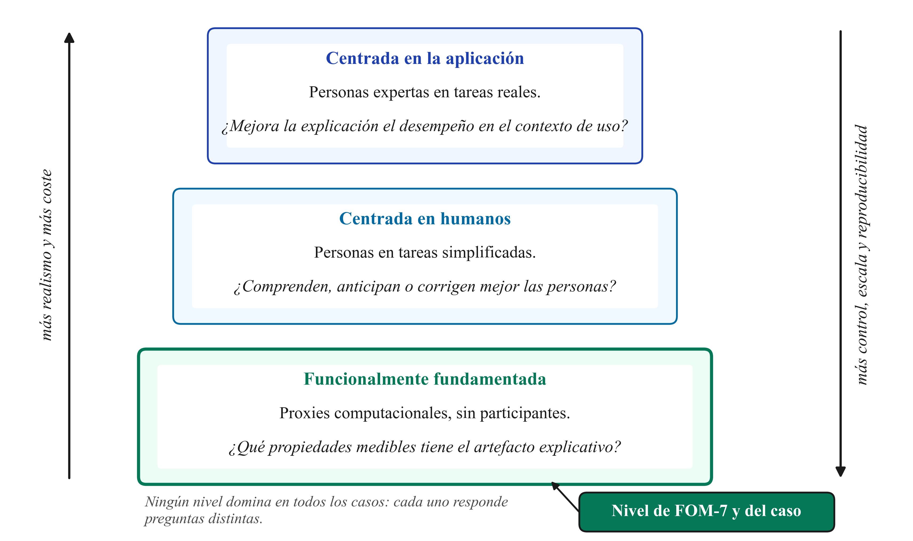

# Qué es y qué no es la inteligencia artificial explicable

## Nociones fundamentales: Transparencia, interpretabilidad y explicabilidad

En la práctica técnica, transparencia, interpretabilidad y explicabilidad suelen confundirse. Para diseñar controles de auditoría eficaces, conviene delimitar sus fronteras operacionales:

* **Transparencia:** Propiedad sistémica del entorno de ingeniería. Describe la accesibilidad del código fuente, linaje y versiones de datos (en DVC o Delta Lake), grafos de ejecución (DAGs en Airflow) y esquemas de validación (Lipton, 2018). Un repositorio público en Git es necesario para auditar, pero no permite anticipar la conducta de un ensamble de mil árboles.
* **Interpretabilidad:** Cualidad intrínseca de una arquitectura matemática que permite a un observador discernir directamente la relación entre entradas y salidas (Murdoch *et al.*, 2019). Un modelo es interpretable por diseño si su estructura equivale a una regla booleana simple o a una regresión con pocos coeficientes.
* **Explicabilidad:** Propiedad extrínseca y activa. Consiste en construir aproximaciones secundarias, sustitutos locales o artefactos visuales —vectores de pesos, reglas de decisión o contrafactuales— para interpretar la inferencia de un clasificador opaco (Phillips *et al.*, 2021).

Como ilustra la Figura 1, ninguna de estas cualidades garantiza por sí sola la **confiabilidad** (*trustworthiness*). Un sistema puede generar explicaciones legibles y mantener sesgos demográficos o inestabilidad ante perturbaciones menores (Tabassi, 2023).

## La trampa de la ingeniería: Atribución estadística frente a causalidad

Un error crítico en XAI consiste en equiparar la **atribución de características** con la **inferencia causal**.

Si un método post-hoc asigna un peso positivo a una columna (por ejemplo, $+0.32$ a *Antigüedad de la Cuenta*), el valor describe únicamente cómo el algoritmo utilizó esa variable para minimizar su función de pérdida. No implica que ejecutar una instrucción SQL (`UPDATE cuentas SET antiguedad = antiguedad + 3`) incremente la solvencia real del usuario (Pearl, 2009).

El caso clásico de predicción de mortalidad por neumonía evidencia este riesgo. Un modelo asignó menor riesgo de muerte a pacientes con antecedentes de asma. El motivo era operativo: estos pacientes eran ingresados directamente en la Unidad de Cuidados Intensivos (UCI), recibiendo atención temprana que reducía su letalidad. El algoritmo capturó fielmente esa correlación en los datos hospitalarios. Un explicador reflejaría que el asma "protege" al paciente. Sin embargo, derivar de allí una política médica —demorando la atención a pacientes asmáticos— sería perjudicial. La explicabilidad mide la **fidelidad descriptiva del modelo**, no la estructura causal del fenómeno real.

## Taxonomía de métodos: Intrínsecos frente a Post-hoc

El ecosistema de XAI se divide en dos paradigmas:

1. **Modelos intrínsecamente interpretables (*Ante-hoc* o por diseño):** Algoritmos transparentes por construcción (regresiones lineales regularizadas, árboles simples o GAMs). Mantienen fidelidad total a su lógica interna sin requerir sustitutos.
2. **Explicaciones a posteriori (*Post-hoc*):** Métodos aplicados sobre modelos opacos ya entrenados (ensambles XGBoost o redes densas). Construyen un sustituto local (*surrogate*) que aproxima la conducta del clasificador en una vecindad específica.

Como detalla la Figura 2, los métodos post-hoc se clasifican en:

* **Específicos del modelo (*Model-specific*):** Exigen acceso a estructuras internas, como gradientes o topologías de árbol (TreeSHAP).
* **Agnósticos al modelo (*Model-agnostic*):** Tratan al clasificador como una caja negra ($x \to f(x)$). Envían perturbaciones sintéticas y analizan las respuestas sin asumir ninguna arquitectura interna (Marcinkevičs & Vogt, 2023).

## Alcance operacional: Explicaciones Locales frente a Globales

El alcance espacial define la escala analítica de la explicación:

* **Alcance Local (*Local Interpretability*):** Explica la decisión sobre una instancia individual (*¿por qué se denegó la transacción #8812?*).
* **Alcance Global (*Global Interpretability*):** Describe la dinámica global del clasificador sobre toda la población (*¿cuáles atributos dominan las decisiones de la cartera?*).

Un principio de ingeniería central: **la suma de explicaciones locales no equivale a una explicación global válida**. Debido a las fronteras de decisión no lineales, promediar atribuciones locales de miles de registros puede enmascarar dinámicas contrapuestas y generar conclusiones erróneas.

## Niveles de evaluación científica: La posición de FOM-7

Doshi-Velez y Kim (2017) clasificaron la evaluación de explicabilidad en tres niveles:

1. **Evaluación basada en la aplicación (*Application-grounded*):** Expertos del dominio (patólogos o analistas de crédito) resuelven problemas en su flujo habitual usando explicaciones, midiendo mejoras en su productividad real.
2. **Evaluación basada en humanos (*Human-grounded*):** Pruebas de laboratorio con usuarios legos evaluando tareas abstractas, como elegir entre dos predicciones según la claridad visual.
3. **Evaluación funcionalmente fundamentada (*Functionally-grounded*):** Métricas matemáticas objetivas (fidelidad de reconstrucción, estabilidad ante perturbaciones, parsimonia y tiempo de CPU por inferencia) sobre bancos de pruebas reproducibles, sin intervención de sujetos humanos.

Como ilustra la Figura 3, el protocolo **FOM-7** opera en el nivel de **evaluación funcionalmente fundamentada**. Esta decisión equivale a implementar pruebas unitarias y de integración en desarrollo de software. Antes de exponer un explicador a pruebas de usuario (*UAT*), el equipo técnico debe certificar que satisface umbrales cuantitativos de estabilidad, fidelidad y latencia.

