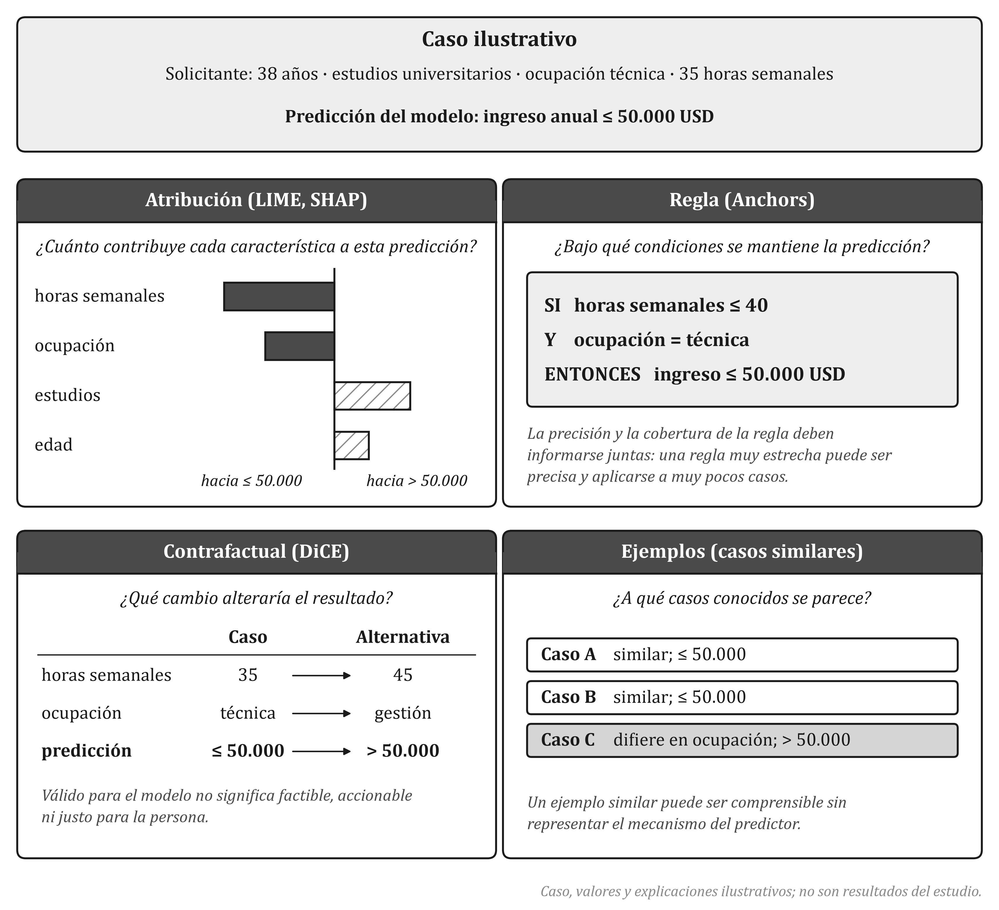
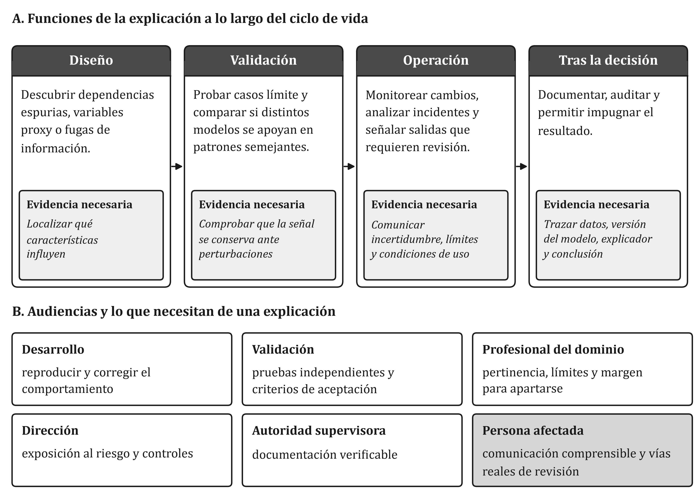

# Métodos de explicabilidad: LIME, SHAP, Anchors y DiCE

## Diversidad de artefactos explicativos

En el desarrollo de software analítico, los métodos agnósticos post-hoc generan diferentes **artefactos explicativos** según las necesidades de la audiencia:

1. **Atribuciones numéricas continuas de características:** Vectores de números reales que ponderan la contribución positiva o negativa de cada variable a la inferencia puntual (LIME, KernelSHAP).
2. **Reglas de decisión booleanas:** Condiciones condicionales (`SI x1 > 3 AND x2 = 'A' ENTONCES predicción = 1`) que delimitan una región de certeza inalterable (Anchors).
3. **Explicaciones contrafactuales prescriptivas:** Muestras sintéticas que indican la alteración mínima en los datos de entrada requerida para conmutar la predicción hacia una categoría deseada (DiCE).

La Figura 4 sintetiza estos cuatro objetos explicativos y sus algoritmos representativos. A continuación se examinan sus mecanismos formales, formulaciones matemáticas y consideraciones de ingeniería.

## LIME: Explicaciones locales interpretables agnósticas al modelo

Propuesto por Ribeiro *et al.* (2016), **LIME** (*Local Interpretable Model-agnostic Explanations*) asume una premisa geométrica intuitiva. Aunque la frontera de un clasificador $f(x)$ sea compleja a escala global, en la vecindad inmediata de un punto $x$ puede aproximarse mediante un plano tangente lineal simple ($g \in G$).

### Mecanismo algorítmico

Para construir la aproximación local alrededor de un registro $x$:

1. **Generación de perturbaciones:** Genera $K$ muestras sintéticas $z'$ en el entorno de $x$. Aplica ruido gaussiano $\mathcal{N}(0, \sigma^2)$ sobre variables continuas y remuestreo empírico sobre las categóricas.
2. **Evaluación de la caja negra:** Envía las muestras $z'$ al clasificador primario para obtener sus probabilidades predichas $f(z')$.
3. **Ponderación por proximidad:** Asigna a cada muestra sintética $z'$ un factor de ponderación $\pi_x(z)$ mediante un núcleo exponencial gaussiano:

$$\pi_x(z) = \exp\left( -\frac{D(x, z)^2}{\sigma^2} \right)$$

donde $\sigma$ define el radio de la vecindad. Si $z$ coincide con $x$ ($D=0$), el peso es máximo ($\pi=1.0$). A mayor distancia, el peso decae hacia cero, confinando la optimización al entorno local.

4. **Ajuste del modelo sustituto:** Ajusta el modelo lineal interpretable $g(z') = w_0 + \sum w_i z'_i$ resolviendo:

$$\xi(x) = \arg\min_{g \in G} \mathcal{L}(f, g, \pi_x) + \Omega(g)$$

donde $\mathcal{L}$ representa el error cuadrático ponderado por $\pi_x$, y $\Omega(g) = \alpha \sum |w_i|$ es una regularización Lasso que induce esparcidad.

### Riesgo operacional: Muestras fuera de distribución (*OOD*)

Desde la perspectiva de datos, la debilidad de LIME radica en perturbar columnas de forma desacoplada. Esta independencia puede violar la integridad lógica del esquema (por ejemplo, combinando `Edad = 18` con `Años_Estudio = 22`). Al recibir registros situados en zonas anómalas (*Out-of-Distribution*, OOD), el clasificador extrapola erráticamente, sesgando los coeficientes del sustituto lineal.

Como ilustra la Figura 5, el núcleo $\pi_x(z)$ concentra la atención sobre la vecindad local (Panel A), permitiendo que la recta tangente $g(z)$ aproxime la frontera no lineal. Sin embargo, ante correlaciones empíricas marcadas (Panel B), la perturbación cartesiana proyecta muestras hacia regiones OOD vacías, distorsionando la estimación de los pesos locales.

## SHAP: Explicaciones aditivas basadas en teoría de juegos cooperativos

Desarrollado por Lundberg y Lee (2017), **SHAP** (*SHapley Additive exPlanations*) formula la atribución de características transformando el problema en un juego cooperativo de teoría de juegos (Shapley, 1953).

### Intuición para el ingeniero de datos

Considere cuatro variables de una tabla (`Ingresos`, `Puntaje_Crediticio`, `Edad`, `Deuda`) que colaboran para emitir una probabilidad $f(x) = 0.85$, frente a una media poblacional $\mathbb{E}[f(X)] = 0.50$. La discrepancia a explicar es $+0.35$. El aporte marginal de `Puntaje_Crediticio` puede ser $+0.20$ de forma aislada. No obstante, al integrarse en una coalición donde `Ingresos` ya está presente, su contribución puede caer a $+0.08$ por redundancia informativa.

Shapley resuelve esta distribución calculando el **aporte marginal promedio de cada variable a través de todas las coaliciones posibles**:

$$\phi_i(x) = \sum_{S \subseteq F \setminus \{i\}} \frac{\vert S \vert ! (\vert F \vert - \vert S \vert - 1)!}{\vert F \vert !} \left[ f_x(S \cup \{i\}) - f_x(S) \right]$$

En esta formulación:

* $F$ representa el conjunto total de características.
* $S$ denota un subconjunto (coalición) que excluye a la variable de interés $i$.
* La diferencia $[f_x(S \cup \{i\}) - f_x(S)]$ mide el cambio en la predicción al incorporar la variable $i$ a la coalición $S$.
* El factor combinatorio $\frac{|S|!(|F|-|S|-1)!}{|F|!}$ pondera uniformemente todas las posibles permutaciones de entrada de las variables.

### Los cuatro axiomas de Shapley

SHAP es el único método local de atribución que satisface simultáneamente cuatro propiedades axiomáticas fundamentales de la teoría de juegos cooperativos (Shapley, 1953; Lundberg & Lee, 2017):

1. **Eficiencia (Aditividad local):** La suma de los valores reconstruye exactamente la desviación respecto al promedio poblacional:
   $$\sum_{i=1}^{\vert F \vert} \phi_i(x) = f(x) - \mathbb{E}[f(X)]$$

2. **Simetría:** Si dos variables $i$ y $j$ realizan aportes idénticos en toda coalición $S \subseteq F \setminus \{i, j\}$ ($f_x(S \cup \{i\}) = f_x(S \cup \{j\})$), reciben igual valor:
   $$\phi_i(x) = \phi_j(x)$$

3. **Jugador nulo (*Dummy*):** Si una columna $i$ no altera la predicción en ninguna coalición ($f_x(S \cup \{i\}) = f_x(S)$), su contribución es cero:
   $$\phi_i(x) = 0$$

4. **Monotonicidad (Consistencia):** Si el aporte marginal de una variable no disminuye entre modelos, su atribución asignada no puede decrecer:
   $$\phi_i(f', x) \ge \phi_i(f, x)$$

### Costo computacional: La explosión combinatoria y KernelSHAP

Para $M$ variables existen $2^M$ coaliciones. Con $M=10$ columnas se evalúan $1,024$ combinaciones. Con $M=30$, el cálculo exacto supera mil millones de evaluaciones ($2^{30} \approx 1.07 \times 10^9$), volviéndose inviable.

Para cajas negras genéricas, **KernelSHAP** estima estos valores mediante regresión ponderada utilizando un núcleo combinatorio:

$$\pi(z') = \frac{|F| - 1}{\binom{|F|}{|z'|} |z'| (|F| - |z'|)}$$

donde $|F|$ es el número total de atributos y $|z'|$ el tamaño de la coalición activa. La formulación asigna los mayores pesos a coaliciones unitarias y cuasi-completas, donde aislar el impacto individual resulta más limpio. Su latencia media bordea $1,180\text{ ms}$ por registro, haciéndolo apto para auditorías por lotes, pero exigente en tiempo real.

La Figura 6 resume esta arquitectura matemática. El Panel A ilustra el retículo booleano de coaliciones $2^{|F|}$. El Panel B expone la curva en U del núcleo KernelSHAP $\pi(z')$, que prioriza los extremos combinatorios. Finalmente, el Panel C grafica la cascada aditiva que satisface la eficiencia local reconstruyendo $f(x)$.

![Figura 6. Teoría de juegos cooperativos y ponderación de coaliciones en SHAP. Panel A: retículo booleano de subconjuntos ($2^{|F|}$) para tres variables y ruta de contribución marginal. Panel B: curva en U del núcleo combinatorio $\pi(z')$ en KernelSHAP, que concentra la masa de ponderación en coaliciones extremas. Panel C: descomposición aditiva en cascada que satisface el axioma de eficiencia local $\sum \phi_i = f(x) - \mathbb{E}[f(X)]$. Fuente: elaboración propia a partir de Lundberg y Lee (2017).](../figures/exported/fig_d10_shap_coaliciones_es.png)

## Anchors: Reglas condicionales con garantías formales

A diferencia de los vectores numéricos, **Anchors** (Ribeiro *et al.*, 2018) genera reglas lógicas `SI-ENTONCES`.

Una regla $A$ (el ancla) reúne predicados booleanos sobre las variables de entrada (por ejemplo, $\text{Edad} > 35 \land \text{Estado\_Civil} = \text{Casado}$). La regla es válida si garantiza que, mientras se cumplan dichos predicados, la predicción se mantendrá invariante bajo el marco PAC (*Probably Approximately Correct*):

$$P\left( \text{prec}(A) \ge 1 - \gamma \right) \ge 1 - \delta$$

donde la precisión local $\text{prec}(A)$ mide la proporción de perturbaciones locales $z$ que preservan la predicción original $f(x)$:

$$\text{prec}(A) = \mathbb{E}_{z \sim D(z|A)} \left[ \mathbb{I}(f(x) = f(z)) \right]$$

En estas formulaciones:

* $\mathbb{I}(\cdot)$ es la función indicadora booleana.
* $D(z|A)$ es la distribución de perturbaciones locales condicionada al cumplimiento de $A$.
* $\gamma$ representa el margen de error admisible (por ejemplo, $\gamma = 0.05$ para exigir $95\%$ de precisión).
* $\delta$ es el nivel de significancia estadística (por ejemplo, $\delta = 0.01$ para un $99\%$ de confianza).

Simultáneamente, el algoritmo busca maximizar la **cobertura** (*coverage*) de la regla en la población:

$$\text{cov}(A) = P_{z \sim D}(A(z) = 1)$$

donde $A(z) = 1$ indica que la instancia cumple las condiciones del ancla. Anchors emplea una búsqueda por haces (*beam search*) guiada por bandidos multi-brazo, optimizando el espacio de reglas sin incurrir en evaluaciones exhaustivas.

## DiCE: Explicaciones contrafactuales diversas y recurso accionable

Propuesto por Mothilal *et al.* (2020), **DiCE** (*Diverse Counterfactual Explanations*) adopta un enfoque prescriptivo. Responde a la pregunta del usuario: *¿cuál es el cambio mínimo en mis datos que conmutaría la decisión del modelo hacia la clase deseada?*

En producción, un contrafactual viable debe respetar restricciones operativas:

* **Variables inmutables:** Atributos intrínsecos como la *Edad* no admiten modificación retroactiva.
* **Dirección monótona:** La *Antigüedad Laboral* solo puede incrementarse.
* **Rangos factibles:** Evitar combinaciones incompatibles con la realidad operativa.

Dado un punto $x$ y una clase deseada $y^*$, DiCE optimiza un conjunto de $k$ contrafactuales $\{c_1, \dots, c_k\}$ resolviendo:

$$\min_{c_1, \dots, c_k} \frac{1}{k} \sum_{i=1}^k \mathcal{L}_{loss}(f(c_i), y^*) + \frac{\lambda_1}{k} \sum_{i=1}^k \text{dist}(x, c_i) - \lambda_2 \text{dpp}(c_1, \dots, c_k)$$

Esta función objetivo balancea tres metas mediante multiplicadores de Lagrange $\lambda_1$ y $\lambda_2$:

* **Validez de clase ($\mathcal{L}_{loss}$):** Conduce la predicción del contrafactual $f(c_i)$ hacia la categoría meta $y^*$.
* **Proximidad ($\text{dist}$):** Minimiza la distancia entre la instancia $x$ y $c_i$, combinando la norma L1 para variables continuas y distancia de Hamming para categóricas.
* **Diversidad ($\text{dpp}$):** Resta el término $\text{dpp}(c_1, \dots, c_k) = \det(\mathbf{K})$, donde $\mathbf{K}$ es la matriz de similitud entre contrafactuales ($K_{i,j} = \frac{1}{1 + \text{dist}(c_i, c_j)}$). Al penalizar configuraciones redundantes, entrega vías de acción cualitativamente diferenciadas.

La Figura 7 compara las geometrías de estos artefactos. El Panel A ilustra el hiper-rectángulo de invarianza de Anchors bajo garantías PAC ($97.4\%$ de precisión local con $22.5\%$ de cobertura). El Panel B esquematiza el balance de fuerzas en DiCE: la tracción de conmutación ($\mathcal{L}_{loss}$), la resistencia de proximidad ($\lambda_1$), la repulsión determinante ($\det \mathbf{K}$) y los topes de inmutabilidad.

![Figura 7. Topología de reglas en Anchors y física multiobjetivo en DiCE. Panel A: hiper-rectángulo de invarianza delimitado por predicados booleanos bajo garantías PAC ($P(\text{prec} \ge 1-\gamma) \ge 1-\delta$) y cobertura empírica asociada. Panel B: balance de vectores de optimización en DiCE que combina la conmutación de clase ($\mathcal{L}_{loss}$), la tracción de proximidad ($\lambda_1$), la repulsión determinante ($\lambda_2 \det(\mathbf{K})$) y las barreras de inmutabilidad. Fuente: elaboración propia a partir de Ribeiro *et al.* (2018) y Mothilal *et al.* (2020).](../figures/exported/fig_d11_anchors_dice_es.png)

## Compromisos operacionales entre explicadores

La selección de un explicador exige ponderar compromisos de diseño (*trade-offs*). Como resume la Figura 8:

* **KernelSHAP:** Máxima solidez axiomática y fidelidad local, con latencia computacional alta ($>1\text{ s}$ por instancia).
* **LIME:** Rápida ejecución ($<50\text{ ms}$) y alta parsimonia, sujeto a inestabilidad estocástica y sensibilidad a datos OOD.
* **Anchors:** Reglas deterministas con certidumbre formal demostrable, con cobertura poblacional acotada ($12\%$--$28\%$).
* **DiCE:** Elevado valor prescriptivo para el usuario, requiriendo optimización numérica multiobjetivo sujeta a restricciones de factibilidad.

