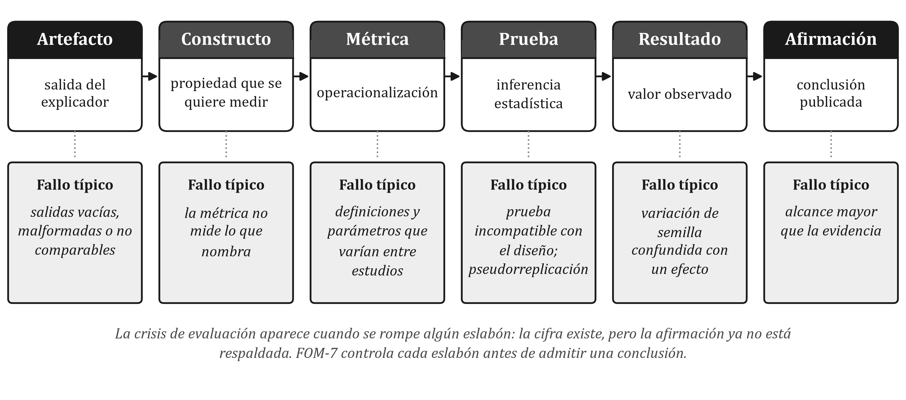
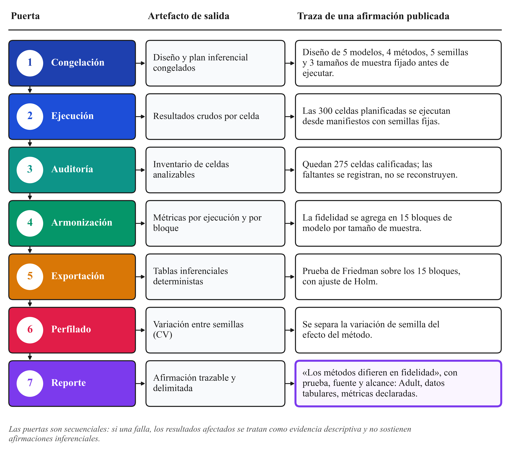

# Crisis de evaluación en XAI

## La crisis de confiabilidad en explicabilidad post-hoc

En ingeniería de software, un módulo se valida mediante pruebas deterministas (`assert output == expected`). En aprendizaje supervisado, el rendimiento se comprueba contrastando predicciones con etiquetas de referencia (*ground truth*).

En la explicabilidad post-hoc enfrentamos una **crisis de evaluación estructural**: **no existe una referencia empírica sobre cómo razona internamente una caja negra** (Krishna *et al.*, 2022; Nauta *et al.*, 2023; Agarwal *et al.*, 2023). Ante la ausencia de un estándar formal, los equipos han recurrido a dos prácticas vulnerables:

1. **Plausibilidad intuitiva:** Asumir que una explicación es correcta si sus variables confirman los sesgos previos del analista.
2. **Métricas circulares:** Evaluar un explicador utilizando las mismas funciones para las que fue optimizado.

Como sintetiza la Figura 9, desplegar un explicador sin controles cuantitativos independientes introduce un segundo componente opaco dentro de la arquitectura de supervisión.

## Taxonomía de riesgos y patologías operacionales

Para un ingeniero de datos que gestiona canalizaciones en producción, las fallas de los explicadores post-hoc se agrupan en cuatro patologías críticas:

### 1. El Efecto Rashomon en explicaciones
Inspirado en Breiman (2001), ocurre cuando múltiples modelos sustitutos obtienen un ajuste numérico equivalente ante la caja negra, pero entregan **jerarquías de atributos contradictorias**. Ambos sustitutos son válidos matemáticamente, pero uno señala a la *Edad* como factor dominante y el otro a la *Deuda*. En una auditoría regulatoria, esta discrepancia destruye la credibilidad técnica del sistema.

### 2. Inestabilidad estocástica y contratos de reproducibilidad
En ingeniería de datos, la reproducibilidad es ineludible: procesar el mismo registro con el mismo pipeline debe generar idéntico resultado. Sin embargo, al depender de muestreos Monte Carlo, **ejecutar dos veces LIME o KernelSHAP sobre la misma instancia con diferente semilla aleatoria altera el orden de las variables explicativas**. En bases de datos corporativas donde las explicaciones se persisten para auditoría, esta volatilidad estocástica genera inconsistencias graves.

### 3. Deformación por muestreo fuera de distribución (*OOD*)
Al perturbar variables de forma independiente para estimar derivadas locales, los explicadores generan combinaciones sintéticas que violan las correlaciones del esquema relacional (por ejemplo, altos salarios en empleos no cualificados). Los modelos, al recibir registros atípicos, devuelven probabilidades erráticas que distorsionan los pesos de atribución resultantes.

### 4. Vulnerabilidad adversarial: Modelos con andamios (*Scaffolding*)
Slack *et al.* (2020) demostraron que los explicadores agnósticos pueden manipularse deliberadamente. Es viable entrenar un clasificador con una bifurcación lógica oculta:

* Aplica una lógica discriminatoria sobre consultas de la distribución operativa real.
* Conmuta hacia un modelo neutral cuando detecta la dispersión característica de las perturbaciones de LIME o SHAP.

Como resultado, el explicador emite un informe que certifica equidad algorítmica, mientras el clasificador discrimina activamente en producción.

La Figura 10 expone cómo cada una de las siete puertas de FOM-7 actúa como una barrera técnica de contención ante estas fallas operacionales.

