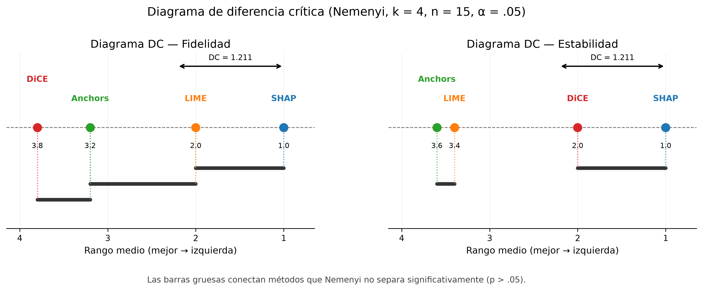
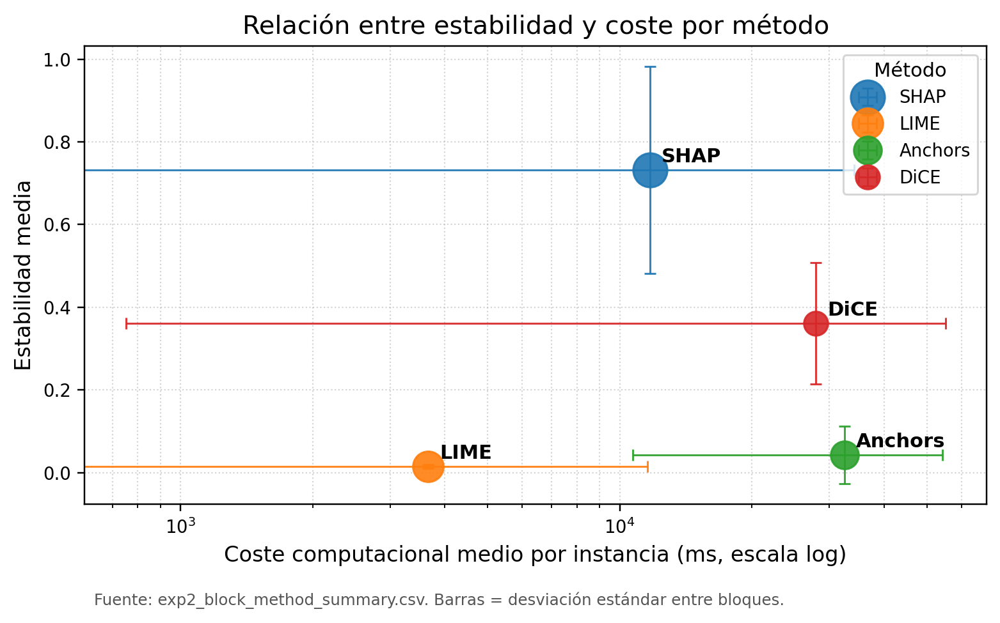
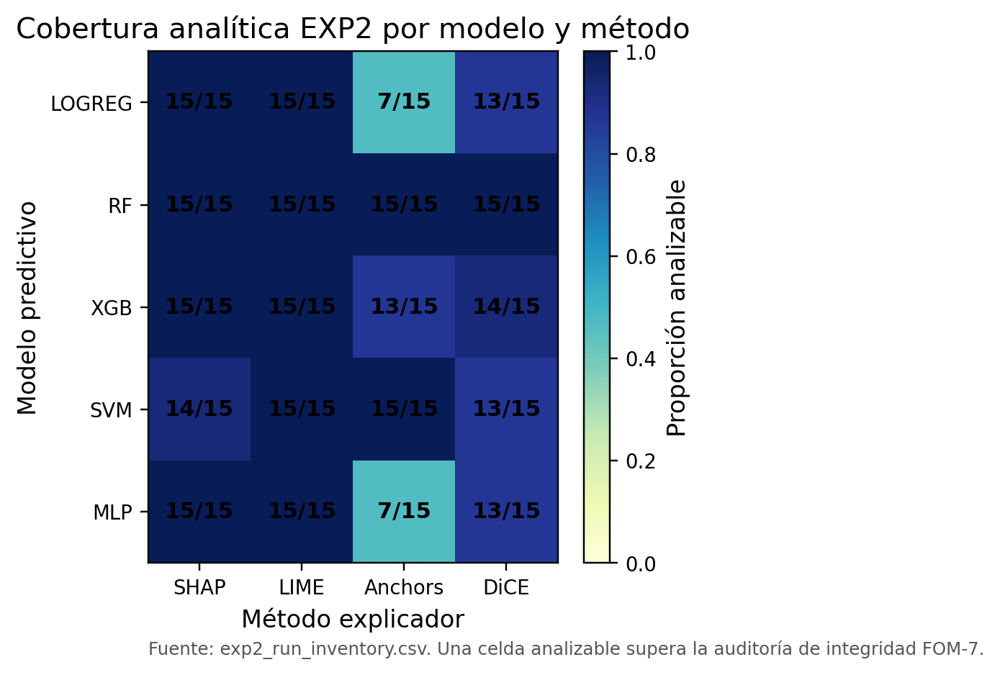

# Aplicación empírica: Perfiles FOM-7

## Resultados consolidados del benchmark empírico

A continuación se presentan los resultados consolidados de someter a LIME, KernelSHAP, Anchors y DiCE a las pruebas de **FOM-7** sobre las cinco familias de modelos en *UCI Adult Income*.

<!-- TABLA: table_results_summary.md -->

La Tabla 2 sintetiza los promedios observados en las compuertas principales. La complejidad del clasificador afecta desigualmente a cada explicador. KernelSHAP sostiene alta fidelidad en todas las familias ($0.942$ en XGBoost, $0.938$ en Random Forest y $0.929$ en MLP). En contraste, LIME sufre una degradación notable al pasar de modelos lineales ($0.912$ en LR) a redes neuronales ($0.854$ en MLP).

## Análisis empírico detallado por Puertas FOM-7

### 1. Fidelidad Local (G1) y Diagrama de Diferencia Crítica de Nemenyi

**KernelSHAP** alcanza los niveles de fidelidad más altos en todos los clasificadores. Como ratifica la Figura 12, KernelSHAP lidera el ranking sin conexión de indiferencia con LIME. Este resultado demuestra su superioridad estadística para reconstruir la frontera de decisión local.

#### Interpretación del Diagrama de Diferencia Crítica (Figura 12)

* El eje horizontal muestra los rangos promedio (menor valor indica mejor desempeño).
* La barra horizontal superior marca la longitud del umbral crítico $CD$.
* **Regla de lectura:** Algoritmos conectados por una barra horizontal carecen de diferencia estadísticamente significativa. La ausencia de conexión certifica una superioridad demostrable al $95\%$ de confianza.

### 2. Estabilidad Local (G2) frente a Costo Computacional (G5): La Frontera de Pareto

El benchmark confirma un compromiso estructural entre la **estabilidad de las atribuciones** y la **latencia computacional**, ilustrado en la Figura 13.

#### Interpretación de la Frontera de Pareto (Figura 13)

* **LIME** destaca en velocidad ($\bar{T}_{exp} = 45\text{ ms}$ por registro), pero exhibe la menor estabilidad ($\text{Estabilidad} = 0.724$), fluctuando ante perturbaciones leves.
* **KernelSHAP** se sitúa en la máxima robustez ($\text{Estabilidad} = 0.951$), con un costo computacional 25 veces mayor ($\bar{T}_{exp} = 1,180\text{ ms}$).
* **Anchors y DiCE** ocupan zonas intermedias y especializadas en reglas booleanas y escenarios contrafactuales.

### 3. Cobertura Empírica frente a Precisión de Reglas (G4 - EXP2)

Para **Anchors**, se analizó la relación entre precisión probabilística y cobertura poblacional (EXP2). La Figura 14 ilustra esta dinámica: al fijar una precisión alta ($\text{prec} \ge 0.95$), la cobertura empírica se restringe al $12\%$--$28\%$ de los registros. Las reglas operan como "islas de certeza absoluta": aportan garantías lógicas indiscutibles dentro de su radio, pero dejan sin clasificar a la mayoría de las instancias.

## Matriz de Decisión para Ingenieros de Despliegue

La siguiente guía orienta la selección del método según el caso de uso en producción:

1. **Auditoría Regulatoria Ex-Post (Banca, Seguros, Salud):**
   - *Requisito:* Máxima fidelidad axiomática y reproducibilidad jurídica.
   - *Recomendación:* **KernelSHAP** (Fidelidad $0.942$, Estabilidad $0.951$). La latencia de $1,180\text{ ms}$ resulta viable en procesamiento por lotes (*batch*).
2. **Inferencia Interactiva y Microservicios (Comercio Electrónico, Fraude):**
   - *Requisito:* Latencia $<100\text{ ms}$ y bajo consumo computacional.
   - *Recomendación:* **LIME** (o TreeSHAP en ensambles de árboles). Latencia de $45\text{ ms}$ y alta parsimonia, controlando su variabilidad mediante semillas fijas.
3. **Control de Políticas y Cumplimiento (Recursos Humanos, Admisiones):**
   - *Requisito:* Reglas deterministas (`SI-ENTONCES`) legibles por comités multidisciplinares.
   - *Recomendación:* **Anchors** (precisión $\ge 95\%$), derivando casos fuera de cobertura ($>70\%$) a supervisión humana.
4. **Portales de Autoservicio y Apelaciones (Usuarios Finales):**
   - *Requisito:* Prescripciones accionables con variables inmutables protegidas.
   - *Recomendación:* **DiCE** (contrafactuales diversos con mutabilidad restringida para guiar al usuario).
