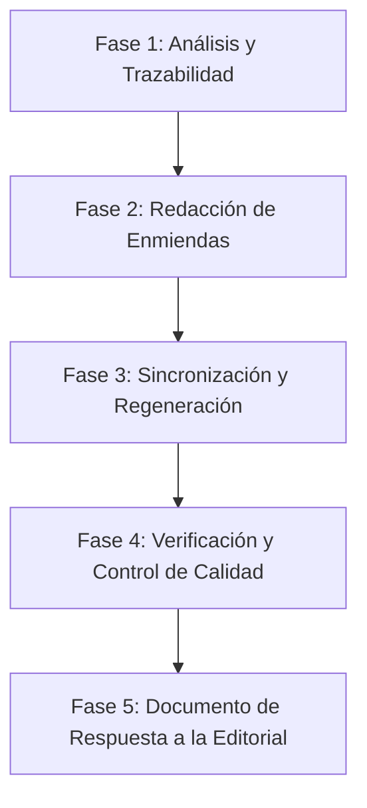

# Plan de Remediación - Revisión 1 (Editora: Irene Arostegui)
**Capítulo de Libro CIFIE/FOM-7 (Editorial Tintazul, 2026)**
*Documento de Planificación y Trazabilidad Metodológica*
**Rama:** `chapter/cifie-revision-1` | **Fecha:** 2026-10-24 | **Rol:** Architect / Scientific Editor

---

## 1. Contexto y Diagnóstico General

El 24 de octubre de 2026 se recibió el manuscrito evaluado por el comité editorial:
`publications/book_chapters/2026_cifie_xai_fom7/drafts/v5_revision_1/capitulo_cifie_xai_fom7_Revision_1.docx`

El documento contiene cinco (5) comentarios críticos realizados por la editora **Irene Arostegui** (fechados el 2026-10-23 entre las 18:27 y las 18:31 UTC). Los comentarios no cuestionan la validez de los resultados numéricos ni la rigurosidad matemática del protocolo FOM-7, sino que exigen una **calibración epistémica, metodológica y estructural** en cinco áreas clave:

1. **Correspondencia Protocolo vs. Benchmark (Comentario 44):** Mapeo explícito entre las 7 compuertas conceptuales de FOM-7 y las 5 métricas primarias del benchmark.
2. **Precisión en Reproducibilidad (Comentario 50):** Matizar "garantizar la reproducibilidad completa" por fijación de semilla y explicitar los mecanismos complementarios de control experimental.
3. **Delimitación de Originalidad y Procedencia (Comentario 54):** Deslindar con nitidez los resultados sintetizados/reproducidos de publicaciones previas (Paper A en RIMI y Tesis Doctoral) respecto de las aportaciones originales y nuevos marcos presentados en este capítulo.
4. **Modestia Epistémica y Terminología de Certificación (Comentario 69):** Sustituir términos absolutos como "validación empírica [global]", "certificar" y "certificación" por "evaluación empírica controlada" y "criterios de aceptación técnica".
5. **Estructura Explícita de Limitaciones (Comentario 71):** Incorporar una sección dedicada y exhaustiva de limitaciones (dataset único, operacionalización métrica, ausencia de validación humana, generalizabilidad) antes de la agenda futura, alineando esta última como respuesta a dichas limitaciones.

---

## 2. Inventario Detallado de Elementos a Remediar

| ID | Revisor / Fecha | Sección / Ubicación en Manuscrito | Diagnóstico del Problema | Acción de Remediación Requerida |
|---|---|---|---|---|
| **REM-01** (Comentario 44) | Irene Arostegui 2026-10-23 18:27 | Sección 07 / Tabla 1 (*Métricas primarias del benchmark*) y Nota al pie | FOM-7 define 7 compuertas ($G_1$–$G_7$), pero la Tabla 1 y el análisis empírico reportan 5 métricas ($F, S, P, \Delta_k, C$). Falta clasificar cuáles puertas fueron evaluadas empíricamente, cuáles mediante proxies/indicadores específicos de objeto (ej. cobertura en Anchors) y cuáles permanecen conceptuales/pendientes de evaluación en este benchmark. | 1. Incorporar una matriz/tabla de trazabilidad explícita (Tabla 1b o ampliación de Tabla 1) vinculando cada compuerta $G_1$–$G_7$ con su estatus de operacionalización. 2. Clasificar en tres niveles: (a) evaluación experimental directa ($G_1, G_2, G_3, G_5$), (b) evaluación por objeto específico ($G_4$ en Anchors/DiCE), y (c) componentes metodológicos del marco reservados para auditorías ampliadas ($G_6, G_7$). 3. Ajustar la prosa explicativa en Secciones 06 y 07. |
| **REM-02** (Comentario 50) | Irene Arostegui 2026-10-23 18:29 | Sección 07 (*Entorno de ejecución y reproducibilidad*) | Afirmar que fijar una semilla (`seed=42`) "garantiza la reproducibilidad completa" es un exceso metodológico. La reproducibilidad depende de hardware, bibliotecas, compiladores, hilos y entorno. | 1. Sustituir "garantizar la reproducibilidad completa" por "favorecer y controlar rigurosamente la reproducibilidad experimental". 2. Detallar la arquitectura multicapa de reproducibilidad: fijación de dependencias por hash/versión (Python 3.10, librerías congeladas), protocolo multillave de 5 semillas para medir variabilidad inter-semilla ($CV < 3\%$), preprocesamiento determinista desacoplado y disponibilidad pública del código y artefactos auditables. |
| **REM-03** (Comentario 54) | Irene Arostegui 2026-10-23 18:29 | Sección 08 / Nota de Tabla de Inferencia Estadística (Tabla 2/3) | Se citan resultados de H1 y H2 tomados de Herrera-Vásquez & Herrero-Uceda (2026, RIMI) y P1 de la tesis doctoral, pero no se delimita formalmente qué es síntesis de antecedentes y qué constituye la contribución original del presente capítulo. | 1. Añadir una subsección explícita de deslinde de contribución en la Introducción (Sección 02) y en la discusión de resultados (Sección 08). 2. Desglosar en tres categorías: (a) *Resultados reproducidos*: contrastes H1, H2 (RIMI) y descriptivos P1 (tesis); (b) *Resultados reanalizados*: integración cruzada cuatripartita (SHAP, LIME, Anchors, DiCE) bajo el prisma multidimensional; (c) *Aportaciones inéditas*: formalización completa del ciclo de 7 compuertas FOM-7, guías para ingeniería de datos/observabilidad, perfiles de compromiso (*trade-offs*) para despliegue y alineación con directrices del AI Act de la UE. |
| **REM-04** (Comentario 69) | Irene Arostegui 2026-10-23 18:30 | Sección 11 (*Conclusiones / Síntesis de aportaciones*) | Uso de términos ambiciosos como "validación empírica" de todo el marco, "certificar" o "certificación". El estudio es en datos tabulares y condiciones controladas; no mide utilidad humana, plausibilidad semántica ni causalidad. | 1. Barrido léxico en todo el manuscrito para eliminar "certificar" y "certificación" cuando se refieran a la evaluación experimental del capítulo. 2. Sustituir por "evaluación empírica controlada", "verificación técnica experimental" o "criterios de aceptación técnica". 3. Reservar el término "certificación" estrictamente para procesos regulatorios formales externos. 4. Reafirmar las fronteras funcionales (Nivel 3 Doshi-Velez & Kim) en las conclusiones. |
| **REM-05** (Comentario 71) | Irene Arostegui 2026-10-23 18:31 | Sección 10/11 (*Alcance, limitaciones y agenda futura*) | La sección de limitaciones quedó absorbida o excesivamente compactada en el borrador final, pasando casi de inmediato a la agenda futura sin delimitar los cuatro ejes de limitación metodológica del estudio. | 1. Restaurar y estructurar formalmente una sección independiente: **"Delimitación de limitaciones metodológicas"** antes de la agenda futura. 2. Desarrollar detalladamente los 4 ejes requeridos por la editora: (i) Dataset tabular único (UCI Adult Income) y restricciones de dominio; (ii) Dependencia de las operacionalizaciones métricas elegidas ($F$ por enmascaramiento univariado, $S$ por coseno); (iii) Alcance funcional computacional sin validación con usuarios humanos (Nivel 3); (iv) Restricciones de generalización y escalabilidad en entornos productivos. 3. Reestructurar la **"Agenda de investigación futura"** articulando cada línea de trabajo como respuesta directa a cada una de las 4 limitaciones delimitadas. |

---

## 3. Plan de Implementación por Fases (Metodología BMAD)

El plan sigue estrictamente el ciclo **BMAD: Analyze → Discuss → Plan → Execute → Verify** estipulado en `.aceconfig`.

### Fase 1: Análisis y Preparación de Fuentes (Completada)
- Rama activa creada: `chapter/cifie-revision-1`.
- Extracción automatizada de los comentarios de `capitulo_cifie_xai_fom7_Revision_1.docx` (mediante scripts Python de inspección XML).
- Análisis de impacto en `manuscript/*.md`, `tables/*.md`, y `references/`.

### Fase 2: Redacción de Enmiendas Textuales (Rol: Scientific Editor)
1. **Modificación de Sección 06 (`06_protocolo_fom7.md`) y Sección 07 (`07_diseno_empirico.md`):**
   - Incorporar la taxonomía de tres niveles para las compuertas FOM-7 ($G_1$–$G_7$).
   - Explicar la correspondencia entre la definición de cada compuerta y las métricas tabulares.
2. **Modificación de Tabla 1 (`tables/table_metrics.md`):**
   - Añadir columna de compuerta asociada o incluir tabla complementaria de correspondencia metodológica.
   - Expandir la nota metodológica precisando el estatus de evaluación de $G_1$–$G_5$ frente a $G_6$–$G_7$.
3. **Modificación de Párrafo de Entorno en Sección 07:**
   - Reformular la oración de la semilla global hacia "favorecer y controlar la reproducibilidad".
   - Detallar la trazabilidad del entorno (dependencias congeladas, hardware, 5 semillas).
4. **Modificación de Sección 02 (`02_introduccion.md`) y Sección 08 (`08_aplicacion_empirica_perfiles_fom7.md`):**
   - Redactar el deslinde de autoría y originalidad: qué viene de RIMI (H1, H2), qué viene de la tesis (P1) y qué se propone por primera vez en este capítulo (protocolo FOM-7, ingeniería de datos, observabilidad de software, gobernanza).
5. **Modificación de Sección 10 (`10_limitaciones_trabajo_futuro.md`) y Sección 11 (`11_conclusiones.md`):**
   - Estructurar los 4 ejes obligatorios de limitaciones.
   - Alinear los párrafos de trabajo futuro como respuesta explícita a cada una de las 4 limitaciones.
   - Ajustar el tono epistémico en conclusiones: erradicar "certificar/certificación" y sustituir por "evaluación empírica inicial / criterios de aceptación técnica".

### Fase 3: Recompilación y Generación de Entregables
1. Ejecutar `python scripts/build_cifie_chapter.py` para generar el documento ensamblado en formato Word (`.docx`) y PDF.
2. Validar que la compilación Pandoc procese sin errores las tablas, figuras e indentación francesa de referencias APA 7.
3. Generar la versión con control de cambios o versión limpia para entrega a la editorial Tintazul.

### Fase 4: Verificación y Salvaguardas de Regresión (Rol: QA Engineer)
1. **RCA-001 (Control de deriva numérica):**
   - Ejecutar `python scripts/pubs/verify_claims.py` para asegurar que ningún valor numérico registrado en `pub/claim_registry.toml` sufra alteraciones inadvertidas.
   - Asegurar que no se introduzcan valores literales de resultados sin respaldo ni se violen invariantes de exclusividad.
2. **RCA-003 (Sincronización y escapes):**
   - Ejecutar `python scripts/pubs/verify_sync.py`.
3. **Control de Estilo APA 7 y Citas:**
   - Verificar que todas las citas sigan el formato autor-fecha y que cada una tenga su entrada correspondiente con enlace DOI en la bibliografía.
   - Confirmar que la regla del 80% de citas $\ge 2024$ se preserve intacta.

### Fase 5: Redacción de la Carta de Respuesta a la Editora (*Response to Reviewers*)
- Elaborar el documento formal de respuesta punto por punto a los comentarios de Irene Arostegui, citando textualmente el comentario original, la respuesta de los autores y el fragmento del manuscrito modificado con indicación de página y sección.

---

## 4. Criterios de Aceptación

- [ ] Todas las cinco (5) observaciones de Irene Arostegui están abordadas en el manuscrito de forma explícita y trazable.
- [ ] No se altera ningún valor empírico del benchmark ni se desalinean los resultados numéricos auditados.
- [ ] La compilación con `scripts/build_cifie_chapter.py` produce un `.docx` limpio y visualmente impecable.
- [ ] Las pruebas de verificación `scripts/pubs/verify_claims.py` y `scripts/pubs/verify_sync.py` pasan sin alertas ni errores.
- [ ] La carta de respuesta editorial está redactada con cortesía académica, precisión metodológica y referencias exactas a las modificaciones efectuadas.
